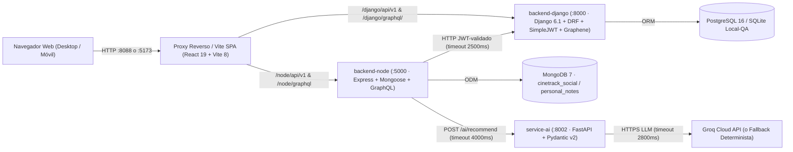
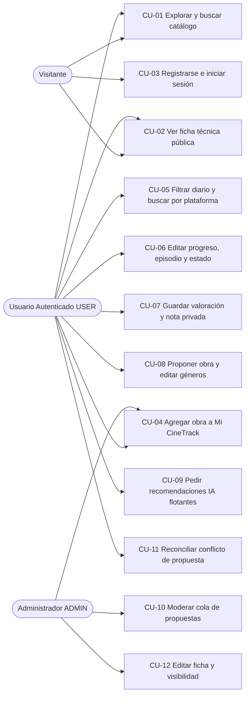
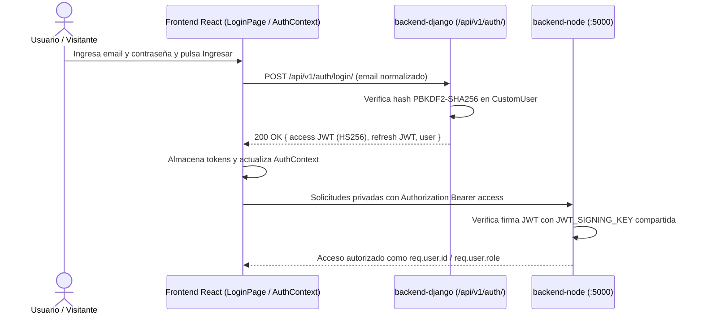
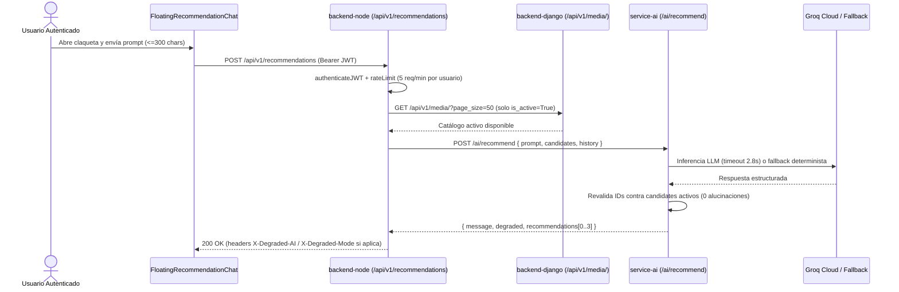
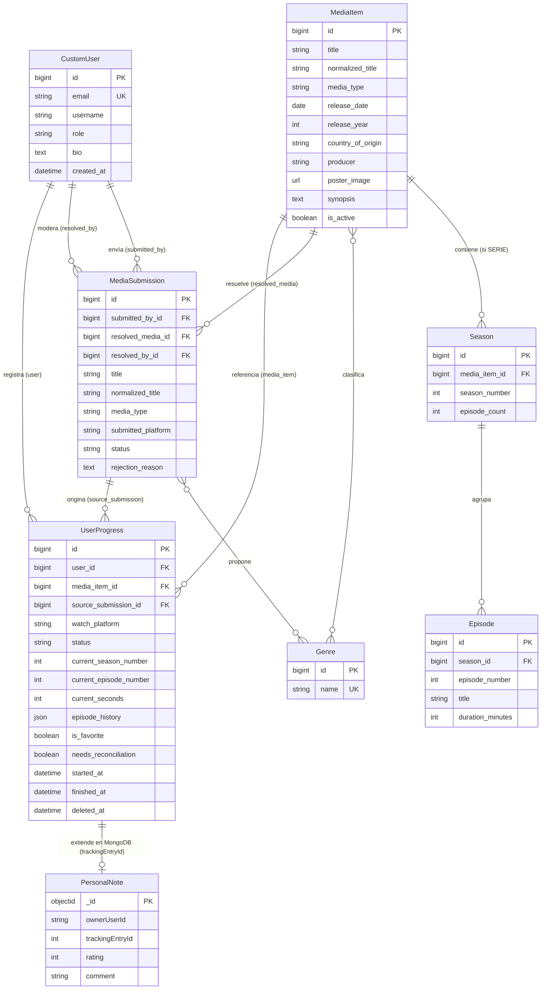

# Especificación de Requerimientos de Software (SRS) — CineTrack

## Carátula Institucional

| Campo | Detalle |
| :--- | :--- |
| **Institución** | Universidad Tecnológica Nacional – Facultad Regional Resistencia (UTN – F.R.Re.) |
| **Sede** | Instituto Tecnológico Goya (ITG) – Goya, Corrientes |
| **Carrera** | Tecnicatura Universitaria en Programación (TUP) |
| **Año** | 2026 |
| **Asignatura** | Trabajo Práctico Integrador (TPI) – Programación IV (ProgIV) |
| **Docentes** | Ing. Juan Manuel Goya (Línea Python) · Prof. Gerardo Ramírez (Línea JavaScript) |
| **Proyecto** | CineTrack: Plataforma Políglota de Catálogo Audiovisual, Diario Privado y Recomendaciones con IA |
| **Documento** | Especificación de Requerimientos de Software bajo el Estándar IEEE 830 |
| **Autores** | Estefanía Borghi · Ariana Alegre Micelli |
| **Normativa** | Reglamento de Estudio: Ord. N° 1622 · Diseño Curricular: Ord. 2018/24 · Sede Central: French 414 (3500) Resistencia – Chaco |
| **Referencia Git** | Rama `main` · Commit de código verificado: `be80184` · Último commit CI verde: `e2578c6` |

---

## Prólogo

El presente Trabajo Práctico Integrador (TPI) se desarrolla en el marco de la Tecnicatura Universitaria en Programación (TUP) de la Universidad Tecnológica Nacional – Facultad Regional Resistencia (Sede Instituto Tecnológico Goya). Este documento formaliza la Especificación de Requerimientos de Software (SRS) del sistema **CineTrack** conforme a los lineamientos de la norma **IEEE Std 830-1998**.

El análisis volcado en estas páginas parte de la inspección directa del código fuente, modelos de persistencia, migraciones, esquemas GraphQL y REST, clientes HTTP, rutas de navegación React y suites de pruebas automatizadas vigentes en el repositorio local. Con rigor técnico y honestidad académica, se distingue explícitamente lo que se encuentra **Implementado en código** y verificado mediante pruebas automáticas de aquello que corresponde a **Funcionalidad retirada / heredada** (como las reseñas públicas sociales y WatchRooms de etapas previas) o **Pendiente / fuera de alcance**.

---

## Dedicatorias y Agradecimientos

### Dedicatorias
Dedicamos este Trabajo Práctico Integrador a nuestras familias y seres queridos, cuyo acompañamiento constante e incondicional hizo posible completar cada etapa de formación en la Tecnicatura Universitaria en Programación.

### Agradecimientos
Agradecemos a la Universidad Tecnológica Nacional – Facultad Regional Resistencia, al Instituto Tecnológico Goya (ITG) y a los docentes de la cátedra de Programación IV (Ing. Juan Manuel Goya y Prof. Gerardo Ramírez) por su guía técnica y acompañamiento durante la integración de las líneas tecnológicas Python y JavaScript.

---

## Resumen y Palabras Clave

### Resumen
Esta SRS especifica **CineTrack**, una plataforma web full-stack de arquitectura políglota orientada al descubrimiento de películas y series y a la gestión privada del progreso audiovisual de cada espectador. La solución se estructura en cuatro módulos de aplicación y un proxy local opcional:

- **`frontend/`**: SPA desarrollada en React 19, Vite 8 y React Bootstrap, con enrutamiento React Router v7 y clientes Axios desacoplados (`djangoClient.js`, `nodeClient.js`).
- **`backend-django/`**: Backend central en Python con Django 6.1.2, Django REST Framework, SimpleJWT (HS256), Graphene GraphQL y OpenAPI 3.0 (`drf-spectacular`), respaldado por PostgreSQL 16 en producción/CI y SQLite en desarrollo/QA local.
- **`backend-node/`**: Backend complementario en Node.js 20+ / Express conectado a MongoDB 7 (Mongoose ODM) para notas privadas (`PersonalNote`), proxy autenticado con rate limiting hacia el servicio de IA y endpoint GraphQL público (`publicMediaDetails`), además del retiro explícito (`410 Gone`) de reseñas públicas heredadas.
- **`service-ai/`**: Microservicio en FastAPI y Pydantic v2 integrado con Groq Cloud API y un motor determinista de respaldo (`degraded: true`) acotado estrictamente a obras publicadas.
- **`proxy/local-proxy.mjs`**: Proxy reverso local en puerto `8088` compatible con Tailscale Serve para acceso multi-dispositivo bajo origen único HTTPS.

El documento especifica **18 Requisitos Funcionales (RF-01 a RF-18)**, **12 Casos de Uso (CU-01 a CU-12)**, requisitos de interfaces externas, atributos no funcionales, modelo de datos relacional y documental, matriz de trazabilidad e inventario completo de operaciones.

**Palabras clave:** CineTrack; IEEE 830; SRS; Programación IV; Django REST Framework; Node.js; Express; MongoDB; PostgreSQL; FastAPI; Groq; React; JWT; GraphQL.

---

## Resumen Ejecutivo

Los espectadores habituales de cine y series consumen títulos distribuidos entre múltiples servicios de streaming, cines y emisoras tradicionales, perdiendo con frecuencia el registro exacto de en qué temporada, episodio o minuto pausaron una obra y mezclando sus anotaciones personales con redes sociales públicas propensas a spoilers.

**CineTrack** resuelve este problema mediante una separación arquitectónica estricta entre el **espacio público compartido** y el **diario privado de usuario**:

1. Cualquier visitante puede explorar el catálogo aprobado (`is_active=True`), utilizar el buscador universal tolerante a tildes, mayúsculas, separadores y sinopsis extensas, y consultar la ficha técnica y temporadas de cada obra.
2. Al registrarse e iniciar sesión, cada usuario accede a **Mi CineTrack** (`/my-tracking`), una pantalla unificada con tres pestañas (**Mis obras**, **Mis propuestas** y **+ Agregar obra**), donde registra su plataforma privada, estado (`PENDIENTE`, `VIENDO`, `VISTO`, `ABANDONADO`), capítulo y posición en horas y minutos sin marcado implícito de episodios ni pérdida de segundos exactos, junto con su puntuación privada de 1 a 5 estrellas y comentario personal almacenado de forma aislada en MongoDB.
3. Si una obra no existe en el catálogo, puede proponerla para revisión administrativa; mientras tanto ya queda incorporada a su diario privado. Desde cualquier pantalla autenticada puede abrir la claqueta flotante **CineTrack IA** para solicitar sugerencias conversacionales acotadas exclusivamente al catálogo publicado.

---

## Índice de Contenidos

1. Introducción
   - 1.1 Propósito
   - 1.2 Alcance
   - 1.3 Definiciones, acrónimos y abreviaturas
   - 1.4 Referencias
   - 1.5 Visión general del documento
2. Descripción general
   - 2.1 Perspectiva del producto
   - 2.2 Funciones del producto
   - 2.3 Características de los usuarios
   - 2.4 Restricciones
   - 2.5 Suposiciones y dependencias
   - 2.6 Requisitos futuros
3. Requisitos específicos
   - 3.1 Requisitos de interfaces externas
   - 3.2 Requisitos funcionales
   - 3.3 Requisitos de rendimiento
   - 3.4 Restricciones de diseño
   - 3.5 Atributos del sistema
   - 3.6 Otros requisitos (No Funcionales)
   - 3.7 Modelo de datos
4. Información de soporte del proyecto
   - 4.1 Metodología y ciclo de vida de desarrollo
   - 4.2 Gestión de riesgos
   - 4.3 Implementación y verificación
   - 4.4 Conclusiones
5. Apéndice A. Matriz de trazabilidad
6. Apéndice B. Inventario de Operaciones / Endpoints / Resolvers
7. Apéndice C. Decisiones de arquitectura
8. Referencias bibliográficas

### Índice de Tablas
- *Tabla 1*: Glosario del dominio de CineTrack
- *Tabla 2*: Acrónimos y abreviaturas técnicas
- *Tabla 3*: Componentes, responsabilidades e interfaces del sistema
- *Tabla 4*: Actores y privilegios en el sistema
- *Tabla 5*: Restricciones de diseño y arquitectura
- *Tabla 6*: Especificación de requerimientos funcionales (`RF-01` a `RF-18`)
- *Tabla 7*: Matriz de permisos por actor
- *Tabla 8*: Catálogo de casos de uso (`CU-01` a `CU-12`)
- *Tabla 9*: Requisitos no funcionales de operación y calidad
- *Tabla 10*: Requisitos no funcionales de seguridad y privacidad
- *Tabla 11*: Parámetros de configuración y límites operativos
- *Tabla 12*: Diccionario de datos — Esquema relacional (`backend-django`)
- *Tabla 13*: Diccionario de datos — Esquema documental (`backend-node` / MongoDB)
- *Tabla 14*: Matriz de gestión de riesgos técnicos y funcionales
- *Tabla 15*: Fuentes de evidencia y resultados de verificación automatizada
- *Tabla 16*: Matriz de trazabilidad `RF` <-> `CU` <-> Código fuente <-> Pruebas
- *Tabla 17*: Inventario completo de endpoints REST, GraphQL e IA
- *Tabla 18*: Decisiones de arquitectura y justificación tecnológica

### Índice de Figuras
- *Figura 1*: Diagrama de arquitectura de componentes y comunicación de CineTrack
- *Figura 2*: Diagrama de casos de uso por actor (Visitante, Usuario, Administrador)
- *Figura 3*: Diagrama de secuencia — Autenticación JWT e inicio de sesión
- *Figura 4*: Diagrama de secuencia — Búsqueda universal, alta en Mi CineTrack y actualización segura de progreso
- *Figura 5*: Diagrama de secuencia — Asistente conversacional flotante CineTrack IA
- *Figura 6*: Diagrama de secuencia — Propuesta comunitaria, moderación administrativa y reconciliación
- *Figura 7*: Diagrama Entidad-Relación (ERD) completo de CineTrack (SQL + MongoDB)

---

## 1. Introducción

### 1.1 Propósito
El propósito de esta Especificación de Requerimientos de Software (SRS) es documentar con precisión académica y trazabilidad verificable los requisitos funcionales, no funcionales, interfaces, modelos de datos y restricciones arquitectónicas de **CineTrack** bajo la norma **IEEE Std 830-1998**, sirviendo como referencia formal para evaluación, defensa del Trabajo Práctico Integrador y mantenimiento evolutivo.

### 1.2 Alcance
**Implementado en el código vigente (`main`):**
- Catálogo público paginado de películas y series (`MediaItem`, `Genre`, `Season`, `Episode`) consultable vía REST y GraphQL.
- Buscador universal tolerante a tildes, mayúsculas, separadores (`+`, `-`, `:`, `_`), conservación de `ñ`, variantes compactas y evaluación completa de sinopsis extensas.
- Identidad centralizada en Django con SimpleJWT (`HS256`) y dos roles consolidados (`USER` y `ADMIN`).
- Módulo privado unificado **Mi CineTrack** (`/my-tracking`, alias `/my-cinetrack`) con pestañas **Mis obras**, **Mis propuestas** y **+ Agregar obra** (alta directa desde catálogo o propuesta comunitaria).
- Editor único de progreso (`TrackingProgressEditor`) con preservación de segundos exactos, cambio de episodio sin marcado implícito ni autoguardado y limpieza coherente de fechas de finalización.
- Notas y puntuaciones privadas (`1..5` estrellas y comentarios hasta 2.000 caracteres) persistidas en MongoDB (`personal_notes`), inaccesibles para terceros o administradores.
- Moderación administrativa sanitizada (publicar, fusionar/vincular con detección de duplicados y rechazo con motivo) más reconciliación manual de colisiones privadas.
- Asistente conversacional flotante **CineTrack IA** (`FloatingRecommendationChat`) conectado a FastAPI + Groq Cloud con modo degradado determinista.

**Retirado / Heredado (presente como código inactivo o respuesta `410`):**
- Reseñas públicas sociales (`backend-node/src/controllers/reviewController.js` responde `410 Gone` en `/api/v1/reviews`) y componentes `frontend/src/components/reviews/*` no montados en `App.jsx`.
- Salas sincronizadas en tiempo real WatchRooms (`frontend/src/pages/WatchRoomPage.jsx`, `components/watchroom/*`, `backend-node/src/services/socketService.js`), sin rutas activas en `frontend/src/App.jsx`.

**Excluido explícitamente del alcance:**
- Reproducción o alojamiento de streaming de video.
- Pasarelas de pago o suscripciones externas.
- Integración o scraping automático en tiempo real contra plataformas externas (Netflix, Prime Video, Disney+, etc.).

### 1.3 Definiciones, acrónimos y abreviaturas

#### Tabla 1: Glosario del dominio de CineTrack
| Término | Definición en el código |
| :--- | :--- |
| **Obra (`MediaItem`)** | Entidad canónica pública (`PELICULA` o `SERIE`) moderada y visible cuando `is_active=True`. |
| **Género (`Genre`)** | Categoría taxonómica normalizada (`16` géneros base) asignada de 1 a 5 por obra o propuesta. |
| **Temporada / Episodio (`Season` / `Episode`)** | Estructura jerárquica exclusiva para obras `media_type="SERIE"` con duración en minutos por episodio. |
| **Mi CineTrack (`UserProgress`)** | Entrada privada única por usuario y obra/propuesta en `tracking_userprogress` con estado, plataforma privada, capítulo, `current_seconds` y favorito. |
| **Nota Privada (`PersonalNote`)** | Documento privado en MongoDB (`personal_notes`) con `rating` entero `1..5` o `null` y `comment` de hasta 2.000 caracteres, indexado por `(ownerUserId, trackingEntryId)`. |
| **Propuesta (`MediaSubmission`)** | Solicitud comunitaria creada por un `USER` con estado `PENDING`, `PUBLISHED`, `MERGED` o `REJECTED` e incorporación inmediata provisional a su diario privado. |
| **Reconciliación (`needs_reconciliation`)** | Estado transitorio de conflicto cuando una propuesta vinculada (`MERGED`) coincide con otra entrada activa del mismo usuario en la obra canónica. |
| **Claqueta Flotante (`ClapperboardLauncher`)** | Botón flotante único para usuarios autenticados que despliega el chat **CineTrack IA**. |
| **Modo degradado (`degraded`)** | Respaldo determinista del microservicio IA cuando no existe `GROQ_API_KEY` o la API externa falla / excede tiempo. |
| **WatchRoom (Heredado)** | Concepto histórico de sala de visualización compartida; actualmente no está enrutado en `App.jsx` y el servicio social legado retorna `410 Gone`. |

#### Tabla 2: Acrónimos y abreviaturas
| Sigla | Significado |
| :--- | :--- |
| **IEEE 830** | Institute of Electrical and Electronics Engineers Standard 830-1998 (SRS). |
| **SRS** | Software Requirements Specification (Especificación de Requerimientos de Software). |
| **TPI / TUP** | Trabajo Práctico Integrador / Tecnicatura Universitaria en Programación. |
| **RF / RNF / CU** | Requisito Funcional / Requisito No Funcional / Caso de Uso. |
| **SPA** | Single Page Application (React 19 + Vite 8). |
| **DRF** | Django REST Framework (`>=3.15.0`). |
| **JWT** | JSON Web Token emitido por SimpleJWT con firma `HS256`. |
| **RBAC** | Role-Based Access Control (roles efectivos `USER` y `ADMIN`). |
| **ORM / ODM** | Object-Relational Mapping (Django) / Object-Document Mapping (Mongoose). |
| **SSRF** | Server-Side Request Forgery (mitigado en portadas externas de `MediaSubmission`). |
| **ERD** | Entity-Relationship Diagram (Diagrama Entidad-Relación). |

### 1.4 Referencias
- Norma **IEEE Std 830-1998**, *IEEE Recommended Practice for Software Requirements Specifications*.
- Repositorio local `BorghiEsteff/TPI-ProgIV`, rama `main` (`be80184`, CI verde `e2578c6`).
- Archivos fuente y configuración inspeccionados: `README.md`, `PRODUCT.md`, `docker-compose.yml`, `.github/workflows/ci.yml`, `proxy/local-proxy.mjs`, `backend-django/` (`core/urls.py`, `users/models.py`, `users/urls.py`, `catalog/models.py`, `catalog/search.py`, `catalog/schema.py`, `catalog/views.py`, `tracking/models.py`, `tracking/serializers.py`, `tracking/views.py`), `backend-node/src/` (`app.js`, `models/PersonalNote.js`, `routes/*.js`, `graphql/schema.js`), `service-ai/main.py` y `frontend/src/` (`App.jsx`, `pages/*.jsx`, `components/**/*.jsx`, `services/*.js`).

### 1.5 Visión general del documento
La **Sección 2** presenta la arquitectura general del sistema, componentes, funciones, actores, restricciones y dependencias. La **Sección 3** formaliza interfaces externas, requisitos funcionales (`RF-01` a `RF-18`), casos de uso, diagramas de secuencia, rendimiento, atributos de calidad, RNF y diccionario de datos SQL/MongoDB. La **Sección 4** documenta metodología, riesgos y verificación ejecutada. Los **Apéndices A, B y C** completan la matriz de trazabilidad, inventario de endpoints y decisiones tecnológicas.

---

## 2. Descripción general

### 2.1 Perspectiva del producto
CineTrack es una aplicación web distribuida e independiente cuyo núcleo transaccional e identitario reside en `backend-django`, apoyado por `backend-node` para persistencia documental flexible en MongoDB y control de tráfico hacia `service-ai`. Toda la experiencia de usuario converge en una única SPA React consumida directamente (`:5173`) o mediante un proxy inverso de origen único (`proxy/local-proxy.mjs` en `:8088` para Tailscale Serve).


*Figura 1: Diagrama de arquitectura de componentes y comunicación de CineTrack.*

#### Tabla 3: Componentes, responsabilidades e interfaces
| Componente | Stack real verificado | Responsabilidad | Interfaz |
| :--- | :--- | :--- | :--- |
| **`frontend`** | React 19.3, Vite 8.3, React Router 7, React Bootstrap 2.10, Axios 1.21 | Catálogo público, detalle de obra, Mi CineTrack unificado, moderación admin y claqueta flotante IA. | REST/GraphQL hacia Django y Node; archivos estáticos en Vite dev/build. |
| **`backend-django`** | Python 3.12+, Django 6.1.2, DRF, SimpleJWT, Graphene-Django, drf-spectacular, django-filter | Emisión y perfil de identidad JWT, catálogo público, buscador universal, propuestas, moderación y `UserProgress`. | REST `/api/v1/*`, GraphQL `/graphql/`, OpenAPI `/api/schema/`, Admin `/admin/`. |
| **`backend-node`** | Node.js 20/22, Express 4.19, Mongoose 8.3, Zod 3.22, express-rate-limit 7.2, jsonwebtoken 9 | CRUD privado de `PersonalNote` en MongoDB, rate limit y proxy `/api/v1/recommendations`, GraphQL `publicMediaDetails`, retiro `410` de reseñas. | REST `/api/v1/personal-notes/*`, `/api/v1/recommendations`, GraphQL `/graphql`. |
| **`service-ai`** | FastAPI, Uvicorn, Pydantic v2, httpx, groq | Ranking y recomendación de hasta 3 obras activas del catálogo vía Groq Cloud o respaldo determinista sin clave. | REST `POST /ai/recommend`, `GET /health` (`:8002`). |
| **Bases de datos** | PostgreSQL 16 Alpine (CI/Docker) · SQLite (dev/QA) · MongoDB 7 | Persistencia relacional transaccional + almacenamiento documental privado. | TCP `5432` / archivo `.sqlite3` y TCP `27017`. |
| **`proxy/local-proxy.mjs`** | Node.js HTTP Proxy (`8088`) | Enrutamiento bajo un origen único (`/`, `/django/`, `/node/`) compatible con Tailscale Serve `.ts.net`. | HTTP `127.0.0.1:8088` (`Implementado en código`). |

### 2.2 Funciones del producto
1. **Exploración y Búsqueda Universal (`CatalogPage.jsx`, `catalog/search.py`):** Paginación de catálogo activo, filtros combinados por tipo (`PELICULA`, `SERIE`) y género, alternancia opcional REST/GraphQL (`VITE_ENABLE_GRAPHQL_TOGGLE` / modo debug) y búsqueda tolerante simétrica.
2. **Identidad y Seguridad (`users/`):** Registro de cuentas (`USER`), autenticación por email en minúsculas + contraseña con emisión de JWT `access`/`refresh`, perfil autenticado y bloqueo estricto de escalada de privilegios.
3. **Mi CineTrack Unificado (`MyTrackingPage.jsx`, `TrackingProgressEditor.jsx`):** Diario privado en tres pestañas (**Mis obras**, **Mis propuestas**, **+ Agregar obra**), filtros de estado (`TODOS`, `PENDIENTE`, `VIENDO`, `VISTO`, `ABANDONADO`, `FAVORITOS`) con conteos globales (`/tracking/summary/`), búsqueda privada por título o `watch_platform` y paginación.
4. **Notas y Valoraciones Privadas (`PersonalNoteEditor.jsx`, `personalNoteController.js`):** Calificación de `1..5` estrellas y comentario privado en MongoDB por cada entrada del diario.
5. **Propuestas Comunitarias, Moderación y Reconciliación (`SubmissionForm.jsx`, `AdminSubmissionsPage.jsx`, `AdminMediaEditPage.jsx`):** Alta rápida o propuesta con portada URL/archivo validada y `1..5` géneros; publicación, fusión o rechazo por `ADMIN`; resolución privada de conflictos (`needs_reconciliation`).
6. **Asistente Flotante IA (`FloatingRecommendationChat.jsx`):** Chat temporal en claqueta flotante con chips rápidos, hasta 3 recomendaciones reales del catálogo publicado, agregado directo al diario y modo limitado ante indisponibilidad de Groq.

### 2.3 Características de los usuarios

#### Tabla 4: Actores y privilegios reales en el código
| Actor | Identificación técnica | Privilegios y restricciones verificadas |
| :--- | :--- | :--- |
| **Visitante** | No autenticado (`AllowAny` solo en lectura pública) | Navega catálogo (`/`, `/media/:id`), busca y filtra obras `is_active=True`. Redirigido a `/login` en rutas privadas (`ProtectedRoute`); recibe `401` en `/tracking/`, `/submissions/`, `/personal-notes` y `/recommendations`. No visualiza `ClapperboardLauncher`. |
| **Usuario Registrado (`USER`)** | `CustomUser.role == "USER"` (consolida antiguo `CRITIC` vía migración `0002`) | Gestiona únicamente su propio diario (`UserProgress`), notas privadas (`PersonalNote`), propuestas propias (edición de géneros solo en `PENDING`), reconciliación y asistente IA flotante. Recibe `403` en `/admin/submissions` y mutaciones de catálogo/géneros. |
| **Administrador (`ADMIN`)** | `CustomUser.role == "ADMIN"` (`IsAdminUserRole`) | Todo lo de `USER` sobre su diario propio + acceso a cola sanitizada (`/admin/submissions`), búsqueda de duplicados, publicación/fusión/rechazo de propuestas y edición/desactivación de `MediaItem` (`/admin/media/:id`). No tiene acceso a notas privadas ajenas en Node (`403`/`404`) ni ve autores/notas en moderación. |

### 2.4 Restricciones

#### Tabla 5: Restricciones de diseño
| Restricción | Detalle y consecuencia en el sistema |
| :--- | :--- |
| **Aislamiento de secretos JWT** | `backend-django` y `backend-node` verifican tokens `HS256` de forma desacoplada; requieren obligatoriamente la misma `JWT_SIGNING_KEY`. |
| **Privacidad no negociable** | Ningún campo de `UserProgress` (`watch_platform`, `current_seconds`, `status`) ni documento `PersonalNote` puede filtrarse a respuestas públicas o cola `ADMIN`. |
| **Seguridad de medios y anti-SSRF** | Las URLs de portadas rechazan esquemas distintos de `http/https`, IPs privadas/reservadas/localhost (`is_private`, `is_loopback`) y archivos `.svg` (`catalog/utils.py`). |
| **Compatibilidad de runtime Node.js** | Las dependencias de testing (`vitest` / `jsdom` / `undici`) exigen Node.js `>=22` (actualizado en `.github/workflows/ci.yml`). |
| **Límites de IA sin alucinaciones** | `service-ai` recibe explícitamente la lista de candidatos activos desde `backend-node`/`backend-django` y descarta cualquier ID devuelto fuera de ese conjunto. |

### 2.5 Suposiciones y dependencias
- **Dependencias de ejecución:** PostgreSQL 16 (o SQLite en entorno local/QA) para Django, MongoDB 7 para `backend-node`, y variables de entorno configuradas (`SECRET_KEY`, `JWT_SIGNING_KEY`, `MONGODB_URI`, `CORS_ALLOWED_ORIGINS` / `CLIENT_ORIGIN`).
- **Servicio externo Groq Cloud:** Opcional; su ausencia (`GROQ_API_KEY=""`) activa el modo fallback determinista (`degraded: true`) garantizando respuesta `200` sin fallo de disponibilidad.
- **Compatibilidad de rutas heredadas:** Los marcadores antiguos `/new-entry` y `/my-submissions` se resuelven mediante redirección segura hacia `/my-tracking?view=add` y `/my-tracking?view=proposals`; `/recommendations` redirige a `/`.

### 2.6 Requisitos futuros
*(Proyectado / Fuera de alcance actual)*: exportación/importación de diario privado (`CSV`/`JSON`), tablero estadístico personal de horas consumidas por género y sistema opcional de notificaciones cuando una propuesta cambia de `PENDING` a `PUBLISHED`/`MERGED`/`REJECTED`.

---

## 3. Requisitos específicos

### 3.1 Requisitos de interfaces externas

#### 3.1.1 Interfaces de usuario
- **Barra de navegación (`AppNavbar.jsx`):** Visitante visualiza `CineTrack`, `Catálogo`, `Iniciar Sesión` y `Registrarse`. Usuario autenticado visualiza `CineTrack`, `Catálogo`, `Mi CineTrack`, nombre de usuario y `Cerrar Sesión`; `ADMIN` añade `Moderación` y badge `ADMIN`.
- **Catálogo (`CatalogPage.jsx`, `MediaFilterBar.jsx`, `MediaCard.jsx`):** Muestra tarjetas con marco 2:3 (`ct-poster-frame`), título, tipo (`SERIE`/`PELICULA`), productora, **año de estreno únicamente** (`release_year` o primeros 4 dígitos de `release_date`), insignias de género, sinopsis truncada a 130 caracteres y botones **Ver ficha** / **Agregar a Mi Progreso**.
- **Detalle (`MediaDetailPage.jsx`):** Ficha completa, acordeón `SeasonAccordion` de temporadas y episodios en series, botón contextual **+ Agregar a Mi CineTrack** / **Abrir mi registro en Mi CineTrack**, y **Editar ficha pública** para `ADMIN`.
- **Mi CineTrack (`MyTrackingPage.jsx`, `TrackingProgressEditor.jsx`, `PersonalNoteEditor.jsx`):** Tarjetas compactas con resumen de plataforma, capítulo y tiempo `HH:MM:SS`, editor desplegable único bajo **Editar progreso** con validación explícita (`noValidate`) y bloque de valoración privada `1..5` estrellas + comentario.
- **Asistente flotante (`FloatingRecommendationChat.jsx`):** Panel fijo en esquina inferior derecha con chips rápidos, tarjetas recomendadas, indicador `Modo limitado` cuando `degraded=true`, soporte teclado (`Tab` / `Escape`) y cero desbordamiento en viewport de `390px`.

#### 3.1.2 Interfaces de hardware
- Sistema ejecutado en navegadores web modernos en computadoras de escritorio (resoluciones probadas `1440x900`) y dispositivos móviles (`390x844`, `320px+`), sin requisitos de GPU para el usuario ni para el servidor cuando se usa Groq o modo determinista.

#### 3.1.3 Interfaces de software
- `djangoClient.js` y `nodeClient.js` (Axios) adjuntan `Authorization: Bearer <access>` e interceptan `401` intentando refresco contra `POST /api/v1/auth/token/refresh/`.
- `backend-node` consume `backend-django` (`GET /api/v1/media/` con timeout `2500ms`) y `service-ai` (`POST /ai/recommend` con timeout `4000ms`).

#### 3.1.4 Interfaces de comunicaciones
- HTTP/HTTPS sobre `application/json` y `multipart/form-data` (subida de portadas JPG/PNG/WEBP).
- Cabeceras de observabilidad de degradación: `X-Degraded-Mode` y `X-Degraded-AI`.
- Soporte opcional Socket.IO deshabilitado funcionalmente en `socketService.js` (mantenido solo para compatibilidad histórica pasiva).

---

### 3.2 Requisitos funcionales

#### Tabla 6: Especificación de requerimientos funcionales (`RF-01` a `RF-18`)
| Código | Nombre | Descripción formal | Prioridad / Evidencia en archivo |
| :--- | :--- | :--- | :--- |
| **RF-01** | Exploración de catálogo público | El sistema debe listar obras con `is_active=True` de forma paginada (`page_size=20` por defecto), filtrables por `media_type` (`PELICULA`/`SERIE`) y `genres`/`genreId` tanto en REST como en GraphQL. | Alta · `catalog/views.py`, `catalog/schema.py`, `CatalogPage.jsx` |
| **RF-02** | Buscador universal simétrico | La búsqueda de texto normaliza `NFKD`, preserva `ñ`, convierte `+` en ` plus `, tolera separadores/variantes compactas (`>=4` chars) sin truncar campos DB (`title`, `producer`, `country_of_origin`, `synopsis`) y controla ruido en consultas de 1–2 chars o símbolos (`Up`, `C++`). | Alta · `catalog/search.py`, `utils/textSearch.js` |
| **RF-03** | Detalle público de obra | La ruta `/media/:id` y su equivalente API exhiben metadatos canónicos, géneros y acordeón de temporadas/episodios únicamente si la obra está activa (o visible para `ADMIN`). | Alta · `MediaDetailPage.jsx`, `SeasonAccordion.jsx` |
| **RF-04** | Registro e inicio de sesión JWT | Registro con email único, username, contraseña validada y biografía opcional, forzando `role='USER'`. Login normaliza email a minúsculas y emite par `access`/`refresh` HS256 con claims `email`, `username` y `role`. | Alta · `users/serializers.py`, `users/views.py`, `LoginPage.jsx`, `RegisterPage.jsx` |
| **RF-05** | Control de acceso RBAC | Visitantes no acceden a recursos privados (`401`); usuarios `USER` no pueden ejecutar acciones administrativas de moderación ni edición de catálogo (`403`). | Alta · `users/permissions.py`, `authMiddleware.js`, `RoleGuard.jsx` |
| **RF-06** | Alta idempotente en Mi CineTrack | Agregar una obra publicada a `UserProgress` crea la entrada (`201`) o retorna la existente activa (`200`) sin duplicar ni perder progreso previo, notificando coherentemente en UI. | Alta · `tracking/views.py` (`create`), `trackingService.js` |
| **RF-07** | Navegación unificada de Mi CineTrack | `/my-tracking` (alias `/my-cinetrack`) integra en pestañas **Mis obras** (`?view=tracking`), **Mis propuestas** (`?view=proposals`) y **+ Agregar obra** (`?view=add`); `/new-entry` y `/my-submissions` redirigen preservando autenticación. | Alta · `App.jsx`, `AppNavbar.jsx`, `MyTrackingPage.jsx` |
| **RF-08** | Filtrado, conteo y búsqueda privada | **Mis obras** filtra por `TODOS`, `PENDIENTE`, `VIENDO`, `VISTO`, `ABANDONADO` y `FAVORITOS` con conteos globales reales (`/tracking/summary/`) y busca por título o plataforma privada (`watch_platform`) en todas las páginas del usuario dueño. | Alta · `tracking/views.py`, `catalog/search.py`, `MyTrackingPage.jsx` |
| **RF-09** | Editor único de progreso | Un único formulario controlado por tarjeta al pulsar **Editar progreso** permite modificar `watch_platform`, `status`, `season`/`episode` (ocultos en `PELICULA`), `hours` (`>=0`), `minutes` (`0..59`), favorito y eliminación confirmada (`Sí, quitar`). | Alta · `TrackingProgressEditor.jsx` |
| **RF-10** | Preservación exacta de segundos | Al guardar cambios de plataforma, estado o favorito sin haber editado horas/minutos ni capítulo, el payload omite `current_seconds` para preservar el valor exacto en backend (ej. `01:24:35` = `5075s`). | Alta · `TrackingProgressEditor.jsx`, `tracking/serializers.py` |
| **RF-11** | Cambio de episodio y cancelación | Al modificar temporada o episodio en series, `hours`/`minutes` se preparan visualmente en `00:00` sin persistir en `onBlur`; solo persiste al pulsar **Guardar progreso** y **Cancelar** revierte el borrador. | Alta · `TrackingProgressEditor.jsx` |
| **RF-12** | Semántica de estado `VISTO` y fechas | `VISTO` significa obra terminada: editar episodio, posición o plataforma estando `VISTO` nunca marca episodios implícitamente en `episode_history`. Pasar de `VISTO` a `VIENDO`, `PENDIENTE` o `ABANDONADO` limpia `finished_at=None` conservando `episode_history`. | Alta · `tracking/serializers.py` (`validate`, `update`) |
| **RF-13** | Notas personales privadas en MongoDB | Cada usuario autenticado guarda, actualiza o elimina su valoración entera `1..5` (o `null`) y comentario (`<=2000` chars) sobre sus propias entradas `UserProgress`, con aislamiento estricto frente a otros `USER` y `ADMIN`. | Alta · `personalNoteController.js`, `PersonalNote.js`, `PersonalNoteEditor.jsx` |
| **RF-14** | Alta rápida y propuesta de obra | Desde `+ Agregar obra`, el usuario busca primero en catálogo publicado o envía una propuesta nueva (`SubmissionForm`) con detección previa de duplicados, `1..5` géneros y portada URL o archivo válido; se crea la entrada privada inmediata + propuesta `PENDING`. | Alta · `SubmissionForm.jsx`, `catalog/views.py` |
| **RF-15** | Seguimiento y edición de propuestas propias | En **Mis propuestas**, el autor ve estado (`PENDING`, `PUBLISHED`, `MERGED`, `REJECTED`), motivo de rechazo o enlace a ficha publicada, pudiendo editar `1..5` géneros solo en `PENDING`. | Alta · `MyTrackingPage.jsx`, `catalog/views.py` (`mine`, `partial_update`) |
| **RF-16** | Moderación administrativa y duplicados | En `/admin/submissions`, `ADMIN` visualiza propuestas sin datos privados del autor ni notas, busca candidatos duplicados y ejecuta `publish`, `merge` o `reject` con bloqueo de concurrencia (`409`). | Alta · `AdminSubmissionsPage.jsx`, `SubmissionQueue.jsx`, `catalog/views.py` |
| **RF-17** | Reconciliación manual de conflictos | Si una fusión (`merge`) genera colisión entre entrada provisional y registro previo del mismo usuario, `MyTrackingPage` expone opciones `keep_canonical` y `apply_archived_progress`. | Media · `tracking/views.py` (`reconcile`), `MyTrackingPage.jsx` |
| **RF-18** | Asistente IA flotante único acceso | `/recommendations` redirige a `/`. Usuarios autenticados consultan recomendaciones mediante `FloatingRecommendationChat` (hasta 3 obras reales `is_active=True`, historial acotado a 6 mensajes, fallback determinista `degraded: true` y rate limit `429`). Endpoints `/api/v1/reviews` retornan `410`. | Alta · `FloatingRecommendationChat.jsx`, `recommendationController.js`, `service-ai/main.py` |

#### Modelado de Casos de Uso


*Figura 2: Diagrama de casos de uso por actor.*

##### Tabla 7: Matriz de permisos por actor
| Funcionalidad / Recurso | Visitante | Usuario (`USER`) | Administrador (`ADMIN`) |
| :--- | :---: | :---: | :---: |
| Explorar catálogo activo, buscar, ver detalle (`/` y `/media/:id`) | Permitido | Permitido | Permitido |
| Registrarse e iniciar sesión (`/register`, `/login`) | Permitido | N/A | N/A |
| Mi CineTrack (`/my-tracking`): ver/editar diario propio y reconciliar | Bloqueado (`401`) | Propio únicamente | Propio únicamente |
| Notas privadas MongoDB (`/api/v1/personal-notes/*`) | Bloqueado (`401`) | Propias únicamente | Bloqueado (`403`/`404` sobre ajenas) |
| Enviar propuesta y editar géneros en `PENDING` | Bloqueado (`401`) | Propias únicamente | Propias únicamente |
| Claqueta flotante CineTrack IA (`/api/v1/recommendations`) | Bloqueado (`401`) | Permitido (con rate limit) | Permitido (con rate limit) |
| Moderar propuestas (`/admin/submissions`) y editar catálogo (`/admin/media/:id`) | Bloqueado (`401`) | Bloqueado (`403`) | Permitido |

##### Tabla 8: Catálogo de Casos de Uso (`CU-01` a `CU-12`)
| ID | Caso de uso | Actor principal | Trazabilidad RF |
| :--- | :--- | :--- | :--- |
| **CU-01** | Explorar y filtrar catálogo público con búsqueda universal | Visitante / `USER` | `RF-01`, `RF-02` |
| **CU-02** | Consultar detalle público de obra y temporadas/episodios | Visitante / `USER` | `RF-03` |
| **CU-03** | Registrar cuenta nueva e iniciar sesión con JWT | Visitante / `USER` | `RF-04`, `RF-05` |
| **CU-04** | Agregar obra publicada a Mi CineTrack de forma idempotente | `USER` | `RF-06`, `RF-07` |
| **CU-05** | Filtrar diario privado y buscar por título o plataforma | `USER` | `RF-08` |
| **CU-06** | Editar progreso, plataforma, episodio y estado preservando segundos | `USER` | `RF-09`, `RF-10`, `RF-11`, `RF-12` |
| **CU-07** | Registrar calificación (1–5) y nota privada en MongoDB | `USER` | `RF-13` |
| **CU-08** | Proponer obra nueva y editar géneros mientras está `PENDING` | `USER` | `RF-14`, `RF-15` |
| **CU-09** | Consultar asistente conversacional flotante CineTrack IA | `USER` | `RF-18` |
| **CU-10** | Moderar propuesta (`publish`, `merge`, `reject`) y prevenir duplicados | `ADMIN` | `RF-16` |
| **CU-11** | Resolver reconciliación privada tras fusión de duplicados | `USER` | `RF-17` |
| **CU-12** | Editar metadatos y visibilidad (`is_active`) de obra pública | `ADMIN` | `RF-01`, `RF-16` |

#### Fichas Detalladas de Casos de Uso

- **CU-01 — Explorar y filtrar catálogo público con búsqueda universal**
  - **Actor principal:** Visitante o `USER`.
  - **Precondición:** Catálogo con obras publicadas (`is_active=True`).
  - **Curso normal:** 1) Accede a `/`. 2) Ingresa texto en **Buscar obra**, selecciona **Tipo** y/o **Género** y presiona **Buscar**. 3) Django aplica `search_media_queryset` sobre obras activas y devuelve resultados ordenados por relevancia. 4) Usuario recorre páginas o presiona **Limpiar**.
  - **Curso alternativo:** Si no hay coincidencias (p. ej. búsqueda de plataforma privada en catálogo público), la UI muestra el estado vacío y el botón **Restablecer filtros**.
  - **Postcondición:** Solo se exhiben obras `is_active=True` con sus datos públicos. (`RF-01`, `RF-02`)

- **CU-02 — Consultar detalle público de obra y temporadas/episodios**
  - **Actor principal:** Visitante o `USER`.
  - **Precondición:** Existe la obra con ID válido.
  - **Curso normal:** 1) Selecciona **Ver ficha**. 2) Navega a `/media/:id`. 3) Visualiza portada, año, país, productora, géneros, sinopsis y acordeón de temporadas si es `SERIE`.
  - **Curso alternativo:** Si la obra está inactiva para un visitante o no existe, muestra mensaje de obra no encontrada.
  - **Postcondición:** Ficha pública consultada sin fuga de notas privadas. (`RF-03`)

- **CU-03 — Registrar cuenta nueva e iniciar sesión con JWT**
  - **Actor principal:** Visitante.
  - **Precondición:** El correo electrónico no está registrado.
  - **Curso normal:** 1) Ingresa a `/register`, completa usuario, correo, contraseñas y biografía opcional, y pulsa **Crear Cuenta**. 2) El backend crea la cuenta con `role='USER'` y contraseña PBKDF2-SHA256. 3) Redirige a `/login`, donde ingresa correo y contraseña y pulsa **Ingresar**, recibiendo JWT `access` y `refresh`.
  - **Curso alternativo:** Contraseñas dispares, correo duplicado o credenciales inválidas (`401`) muestran alerta inline sin autenticar.
  - **Postcondición:** Sesión iniciada con token válido en `AuthContext`. (`RF-04`, `RF-05`)

- **CU-04 — Agregar obra publicada a Mi CineTrack de forma idempotente**
  - **Actor principal:** `USER`.
  - **Precondición:** Usuario autenticado y obra activa.
  - **Curso normal:** 1) Pulsa **Agregar a Mi Progreso** en catálogo, **+ Agregar a Mi CineTrack** en `/media/:id`, o busca en `/my-tracking?view=add` y pulsa **Agregar a Mi CineTrack**. 2) `POST /api/v1/tracking/` crea `UserProgress` con estado `PENDIENTE`.
  - **Curso alternativo:** Si la obra ya estaba en su diario, el backend responde `200 OK` devolviendo el registro existente sin duplicar y la UI informa el estado idempotente.
  - **Postcondición:** Existe exactamente una entrada activa para `(user, media_item)`. (`RF-06`, `RF-07`)

- **CU-05 — Filtrar diario privado y buscar por título o plataforma**
  - **Actor principal:** `USER`.
  - **Precondición:** Usuario autenticado en `/my-tracking`.
  - **Curso normal:** 1) Selecciona un estado (`TODOS`, `PENDIENTE`, `VIENDO`, `VISTO`, `ABANDONADO`, `FAVORITOS`) o escribe en **Buscar en mi diario...** (ej. `Disney+`). 2) `search_tracking_queryset` filtra globalmente entre todas las páginas del usuario por título o `watch_platform` y actualiza la lista junto con `/tracking/summary/`.
  - **Curso alternativo:** Sin coincidencias, la barra de filtros permanece visible para limpiar con **Ver todas**.
  - **Postcondición:** Se visualizan únicamente registros del usuario autenticado. (`RF-08`)

- **CU-06 — Editar progreso, plataforma, episodio y estado preservando segundos**
  - **Actor principal:** `USER`.
  - **Precondición:** Registro activo en **Mis obras**.
  - **Curso normal:** 1) Pulsa **Editar progreso** sobre la tarjeta. 2) Modifica `Plataforma`, `Estado`, `Temp.`/`Ep.` (si es `SERIE`) o `Horas`/`Minutos`. Si cambia de capítulo, el formulario prepara `00:00` sin autoguardar. 3) Pulsa **Guardar progreso**. 4) Si no editó el tiempo, el payload omite `current_seconds` conservando segundos exactos previos; en backend, si ya estaba `VISTO` y cambia de capítulo, no agrega el episodio a `episode_history`.
  - **Curso alternativo:** Minutos `>= 60` o valores inválidos muestran alerta inline sin enviar solicitud; **Cancelar** restaura el borrador; fallo de red `500` muestra alerta roja sin éxito falso; **Quitar del diario** + **Sí, quitar** aplica borrado lógico.
  - **Postcondición:** Progreso, fechas coherentes (`finished_at=None` si sale de `VISTO`) e historial actualizados sin corrupción. (`RF-09`, `RF-10`, `RF-11`, `RF-12`)

- **CU-07 — Registrar calificación (1–5) y nota privada en MongoDB**
  - **Actor principal:** `USER`.
  - **Precondición:** Sesión JWT válida y tarjeta visible en **Mis obras**.
  - **Curso normal:** 1) Selecciona entre 1 y 5 estrellas (o **Limpiar**). 2) Escribe comentario (`<=2000` chars). 3) Pulsa **Guardar nota privada**. 4) `backend-node` valida el JWT, ejecuta `upsert` en `personal_notes` filtrando por `ownerUserId` y muestra `Nota privada guardada.`.
  - **Curso alternativo:** Error de red o servidor en Node muestra alerta de error sin marcar guardado exitoso.
  - **Postcondición:** Valoración y nota persisten tras recargar página, invisibles para otros usuarios o `ADMIN`. (`RF-13`)

- **CU-08 — Proponer obra nueva y editar géneros mientras está `PENDING`**
  - **Actor principal:** `USER`.
  - **Precondición:** Sesión iniciada y título no encontrado en catálogo.
  - **Curso normal:** 1) Abre `+ Agregar obra` en **Mi CineTrack**. 2) Completa `SubmissionForm` (título, tipo, plataforma, portada URL o JPG/PNG/WEBP, `1..5` géneros) y pulsa **Guardar en Mi CineTrack y enviar a revisión**. 3) Django crea `MediaSubmission (PENDING)` y `UserProgress` provisional inmediato. 4) En **Mis propuestas**, mientras esté `PENDING`, puede usar **Editar categorías** -> **Guardar categorías**.
  - **Curso alternativo:** URL privada SSRF, archivo `.svg`, `0` géneros o `>5` géneros son rechazados con mensaje claro.
  - **Postcondición:** Propuesta en cola `PENDING` y seguimiento privado activo para el autor. (`RF-14`, `RF-15`)

- **CU-09 — Consultar asistente conversacional flotante CineTrack IA**
  - **Actor principal:** `USER`.
  - **Precondición:** Usuario autenticado en cualquier vista.
  - **Curso normal:** 1) Abre la claqueta flotante (`ClapperboardLauncher`). 2) Selecciona un chip rápido o envía consulta (`<=300` chars en UI; `<=500` chars en API). 3) `backend-node` obtiene catálogo activo de Django y llama a `POST /ai/recommend` en `service-ai`. 4) Muestra hasta 3 tarjetas con **Ver ficha** y **Agregar**.
  - **Curso alternativo:** Sin `GROQ_API_KEY` o ante timeout de Groq, devuelve recomendaciones deterministas con aviso `Modo limitado`; exceso de tasa devuelve `429`.
  - **Postcondición:** Usuario descubre obras activas reales sin alucinaciones de títulos inexistentes. (`RF-18`)

- **CU-10 — Moderar propuesta (`publish`, `merge`, `reject`) y prevenir duplicados**
  - **Actor principal:** `ADMIN`.
  - **Precondición:** Rol `ADMIN` en `/admin/submissions`.
  - **Curso normal:** 1) Filtra propuestas (`Pendientes`). 2) Pulsa **Buscar duplicados**, revisa candidatos similares y ejecuta **Publicar como obra nueva** (o **Confirmar y publicar como obra nueva** si `confirm_new=true`), **Vincular** / **Vincular por ID**, o **Rechazar propuesta** con motivo obligatorio.
  - **Curso alternativo:** Si otro administrador procesó la propuesta previamente, el backend devuelve `409 Conflict`.
  - **Postcondición:** Propuesta resuelta; si fue publicada/vinculada, los `UserProgress` asociados pasan a apuntar a la obra canónica. (`RF-16`)

- **CU-11 — Resolver reconciliación privada tras fusión de duplicados**
  - **Actor principal:** `USER`.
  - **Precondición:** El mismo usuario tenía un seguimiento previo de la obra canónica y además propuso otra que fue `MERGED`.
  - **Curso normal:** 1) Entra a **Mi CineTrack** y ve el panel **Reconciliación pendiente**. 2) Elige **Conservar entrada actual** (`keep_canonical`) o **Aplicar avance de propuesta** (`apply_archived_progress`).
  - **Curso alternativo:** Cancelar o diferir mantiene ambas entradas marcadas hasta su resolución explícita.
  - **Postcondición:** Conflicto resuelto preservando datos y notas del autor. (`RF-17`)

- **CU-12 — Editar metadatos y visibilidad (`is_active`) de obra pública**
  - **Actor principal:** `ADMIN`.
  - **Precondición:** Rol `ADMIN` autenticado en `/admin/media/:id`.
  - **Curso normal:** 1) Desde la ficha de una obra pulsa **Editar ficha pública**. 2) Modifica título, tipo, productora, portada, año, país, sinopsis, géneros o interruptor **Visible en catálogo público** y pulsa **Guardar cambios**.
  - **Curso alternativo:** Falta de géneros válidos o URL inválida bloquea guardado.
  - **Postcondición:** Catálogo público actualizado inmediatamente sin alterar entradas privadas de usuarios. (`RF-01`, `RF-16`)

#### Diagramas de Secuencia de Flujos Críticos


*Figura 3: Diagrama de secuencia — Autenticación JWT e inicio de sesión.*

```mermaid
sequenceDiagram
    actor U as Usuario Autenticado
    participant FE as MyTrackingPage + TrackingProgressEditor
    participant DJ as backend-django (UserProgressViewSet)
    participant DB as PostgreSQL / SQLite

    U->>FE: Escribe en "Buscar en mi diario..." (ej. Disney+)
    FE->>DJ: GET /api/v1/tracking/?search=Disney%2B
    DJ->>DJ: search_tracking_queryset (normalización simétrica)
    DJ-->>FE: Resultados filtrados del usuario + summary/
    U->>FE: Abre "Editar progreso", edita plataforma sin tocar horas/min
    FE->>FE: Verifica timeEdited=false -> omite current_seconds
    FE->>DJ: PATCH /api/v1/tracking/{id}/ { watch_platform: "Disney+" }
    DJ->>DB: Actualiza watch_platform; preserva current_seconds y episode_history si ya VISTO
    DJ-->>FE: 200 OK registro actualizado
```
*Figura 4: Diagrama de secuencia — Búsqueda privada y actualización segura de progreso.*


*Figura 5: Diagrama de secuencia — Asistente conversacional flotante CineTrack IA.*

```mermaid
sequenceDiagram
    actor A as Usuario A
    actor ADM as Administrador
    participant DJ as backend-django (/submissions & /admin/submissions)

    A->>DJ: POST /api/v1/submissions/ (título, 1..5 géneros, portada validada)
    DJ->>DJ: Crea MediaSubmission(PENDING) + UserProgress(source_submission)
    DJ-->>A: 201 Created (visible inmediato en Mis obras y Mis propuestas)
    ADM->>DJ: GET /api/v1/admin/submissions/?status=PENDING
    DJ-->>ADM: Cola sanitizada (sin notas privadas ni identidad del autor)
    ADM->>DJ: POST /api/v1/admin/submissions/{id}/merge/ { target_media_id }
    DJ->>DJ: Transacción atómica; detecta colisión en UserProgress
    DJ-->>ADM: 200 OK { status: "MERGED" }
    A->>DJ: POST /api/v1/tracking/{id}/reconcile/ { resolution }
    DJ-->>A: Conflicto resuelto conservando diario y notas de A
```
*Figura 6: Diagrama de secuencia — Propuesta comunitaria, moderación administrativa y reconciliación.*

---

### 3.3 Requisitos de rendimiento
- **RNF-PERF-01:** El buscador tolerante `search_media_queryset` debe evaluar al menos `1.000` obras activas y responder en menos de `1,5` segundos (verificado en `test_bus23_performance_1000_items`).
- **RNF-PERF-02:** Listados públicos (`/api/v1/media/`) y diario privado (`/api/v1/tracking/`) utilizan paginación DRF (`page_size=20` por defecto, evitando consultas sin límite y renderizado simultáneo de editores pesados en todas las tarjetas).
- **RNF-PERF-03:** El cliente frontend aplica debounce de `250 ms` en la búsqueda del diario (`MyTrackingPage.jsx`) y cancelación lógica por secuencia (`requestSeqRef`) para evitar condiciones de carrera entre peticiones.
- **RNF-PERF-04:** Timeouts acotados entre servicios: `DJANGO_TIMEOUT_MS=2500`, `AI_TIMEOUT_MS=4000`, timeout interno Groq `2.8s`.

---

### 3.4 Restricciones de diseño
- Arquitectura multi-servicio desacoplada con separación de responsabilidades entre bases relacionales (`PostgreSQL`/`SQLite`) y documentales (`MongoDB`).
- Uso de validadores explícitos en fronteras de red: DRF `Serializers` + `clean()` en Python; esquemas **Zod** (`personalNoteValidator.js`, `recommendationValidator.js`) en Node.js; **Pydantic v2** (`schemas.py`) en FastAPI.
- Formularios React controlados con `noValidate` en `TrackingProgressEditor.jsx` para evitar coerciones silenciosas y garantizar mensajes de validación uniformes.

---

### 3.5 Atributos del sistema
- **Seguridad:** Contraseñas cifradas con PBKDF2-SHA256; tokens JWT HS256 con expiración y renovación; protección Helmet y CORS estricto por lista blanca (`CLIENT_ORIGIN` / `CORS_ALLOWED_ORIGINS`); anti-SSRF en descarga/referencia de portadas; protección ante prompt injection en `service-ai`.
- **Integridad de datos:** Restricciones `UniqueConstraint` y `CheckConstraint` en `UserProgress` impidiendo registros huérfanos o duplicados activos; transacciones atómicas (`transaction.atomic()`) y bloqueo de concurrencia (`409 Conflict`) en moderación.
- **Fiabilidad:** Respaldo determinista automático en IA (`degraded: true`) y tolerancia controlada ante indisponibilidad temporal de MongoDB (el diario Django sigue operando sin bloquear la vista si falla la carga batch de notas).
- **Mantenibilidad y Verificabilidad:** Cobertura automatizada independiente por módulo (`pytest`, `jest`, `vitest`, `playwright`) y pipeline CI unificado en `.github/workflows/ci.yml`.
- **Usabilidad y Accesibilidad:** Diseño responsivo sin scroll horizontal entre `390px` y `1440px`, controles accesibles por teclado (`aria-label` en estrellas, `Escape` en modal de chat flotante).

---

### 3.6 Otros requisitos (No Funcionales)

#### Tabla 9: Requisitos no funcionales de operación y calidad
| Código | Categoría | Especificación |
| :--- | :--- | :--- |
| **RNF-01** | Portabilidad / Despliegue | Orquestación completa reproducible mediante `docker-compose.yml` (6 contenedores + red `cinetrack-net`) y ejecución local multiplataforma (Windows/Linux). |
| **RNF-02** | Contratos API | Documentación OpenAPI 3.0 autogenerada en `/api/schema/` y `/api/docs/` (`drf-spectacular`) y esquemas GraphQL tipados en Django y Node. |
| **RNF-03** | Responsividad | Cero desbordamiento horizontal (`scrollWidth <= innerWidth + 2`) en catálogo, diario y panel IA tanto en `1440x900` como en `390x844`. |
| **RNF-04** | Integridad histórica | Los endpoints retirados (`/api/v1/reviews/*`) deben responder explícitamente `410 Gone` informando la transición a `/api/v1/personal-notes`. |

#### Tabla 10: Requisitos no funcionales de seguridad y privacidad
| Código | Categoría | Especificación |
| :--- | :--- | :--- |
| **RNF-05** | Anti-escalada de roles | Cualquier parámetro `role` o flag administrativo enviado en registro o `PATCH /api/v1/auth/me/` debe ignorarse manteniendo el rol asignado. |
| **RNF-06** | Aislamiento horizontal (IDOR) | Ningún usuario autenticado (`USER` ni `ADMIN`) puede leer, editar o eliminar `UserProgress` o `PersonalNote` perteneciente a otro `userId`. |
| **RNF-07** | Cola admin sanitizada | Los serializadores administrativos de `MediaSubmission` omiten datos personales privados y nunca devuelven el `PersonalNote` del proponente. |
| **RNF-08** | Control de tráfico IA | `recommendationRoutes.js` limita solicitudes por usuario autenticado retornando `429 RATE_LIMIT_EXCEEDED` ante abuso. |

#### Tabla 11: Parámetros abiertos y límites configurados
| Parámetro | Valor configurado en código / env | Ubicación |
| :--- | :--- | :--- |
| Géneros por obra o propuesta | Mínimo `1`, máximo `5` (`PENDING` editable) | `SubmissionForm.jsx`, `GenreMultiSelect.jsx` |
| Longitud de comentario privado | Máximo `2000` caracteres (`rating`: entero `1..5` o `null`) | `PersonalNote.js`, `PersonalNoteEditor.jsx` |
| Longitud de prompt IA | Máximo `300` caracteres en UI / `500` en API (historial: últimos `6` mensajes) | `FloatingRecommendationChat.jsx`, `service-ai/schemas.py` |
| Recomendaciones máximas por respuesta | Hasta `3` obras activas reales | `FloatingRecommendationChat.jsx`, `service-ai` |
| Límite de consulta buscador | Máximo `200` caracteres para consulta (`MAX_QUERY_CHARS`), campos DB sin truncar | `backend-django/catalog/search.py` |
| Rate limit IA | `5` peticiones/minuto por usuario por defecto (`RECOMMEND_RATE_LIMIT_PER_MIN`) | `backend-node/src/routes/recommendationRoutes.js` |

---

### 3.7 Modelo de datos


*Figura 7: Diagrama Entidad-Relación (ERD) completo de CineTrack (SQL + MongoDB).*

#### Tabla 12: Diccionario de datos — Esquema relacional (`backend-django`)
| Entidad / Tabla | Campos principales y tipos | Claves e integridad | Propósito |
| :--- | :--- | :--- | :--- |
| **`CustomUser`** (`users_customuser`) | `id` (BigInt), `email` (Email), `username` (Char 150), `role` (`USER`\|`ADMIN`), `bio` (Text), `created_at` (DateTime) | `PK(id)`, `UK(email)`, `USERNAME_FIELD='email'` | Autoridad única de cuentas, roles y credenciales. |
| **`Genre`** (`catalog_genre`) | `id` (BigInt), `name` (Char 100) | `PK(id)`, `UK(name)` | Catálogo taxonómico de géneros audiovisuales (`16` base). |
| **`MediaItem`** (`catalog_mediaitem`) | `id`, `title` (Char 255), `normalized_title`, `media_type` (`SERIE`\|`PELICULA`), `release_date`, `release_year`, `country_of_origin`, `tags` (JSON), `producer`, `poster_image` (URL), `synopsis` (Text), `is_active` (Bool) | `PK(id)`, Índices `(media_type, is_active)`, `(release_date, title)`, `(normalized_title, media_type)` | Ficha pública canónica del catálogo audiovisual. |
| **`Season`** (`catalog_season`) | `id`, `media_item_id`, `season_number`, `episode_count` | `PK(id)`, `FK(media_item)`, `UK(media_item, season_number)`; prohibido en `PELICULA` vía `clean()` | Estructura de temporadas por serie. |
| **`Episode`** (`catalog_episode`) | `id`, `season_id`, `episode_number`, `title`, `duration_minutes` | `PK(id)`, `FK(season)`, `UK(season, episode_number)` | Episodios individuales y duración por temporada. |
| **`MediaSubmission`** (`catalog_mediasubmission`) | `id`, `submitted_by_id`, `title`, `normalized_title`, `media_type`, `poster_url`, `poster_file`, `submitted_platform`, `release_year`, `country_of_origin`, `genres` (M2M), `status` (`PENDING`\|`PUBLISHED`\|`MERGED`\|`REJECTED`), `resolved_media_id`, `rejection_reason`, `resolved_by_id`, `resolved_at` | `PK(id)`, `FK(submitted_by, resolved_media, resolved_by)`, Índices `(status, created_at)`, `(normalized_title, media_type)` | Flujo comunitario de propuestas y trazabilidad de moderación. |
| **`UserProgress`** (`tracking_userprogress`) | `id`, `user_id`, `media_item_id`, `source_submission_id`, `watch_platform`, `status` (`PENDIENTE`\|`VIENDO`\|`VISTO`\|`ABANDONADO`), `started_at`, `finished_at`, `current_season_number`, `current_episode_number`, `current_seconds`, `episode_history` (JSON), `is_favorite`, `needs_reconciliation`, `deleted_at`, `updated_at` | `PK(id)`, `CheckConstraint` exactamente un objetivo (`media_item` XOR `source_submission`), `UniqueConstraint` activos por usuario/obra y usuario/propuesta | Diario privado de progreso audiovisual sin exposición pública. |

#### Tabla 13: Diccionario de datos — Esquema documental (`backend-node` / MongoDB)
| Colección | Campos y validaciones Zod/Mongoose | Índices y seguridad | Propósito |
| :--- | :--- | :--- | :--- |
| **`personal_notes`** (`PersonalNote`) | `_id` (ObjectId), `ownerUserId` (String req), `trackingEntryId` (Number req), `rating` (Integer `1..5` \| `null`), `comment` (String max `2000`), `createdAt`, `updatedAt` | Índice único compuesto `(ownerUserId: 1, trackingEntryId: 1)`; solo consulta/edición cuando `ownerUserId === req.user.id` | Notas personales privadas desacopladas del núcleo SQL. |

---

## 4. Información de soporte del proyecto

### 4.1 Metodología y ciclo de vida de desarrollo
El proyecto se organizó mediante entregas iterativas incrementales alineadas a los trabajos prácticos TP0 a TP5 y lotes posteriores de consolidación funcional y QA:
- **Rama integradora `main`** y ramas históricas preservadas por módulo/hito (`backend-django`, `backend-node`, `frontend`, `feature/django-*`, `feat/*`, `fix/*`).
- **Disciplina TDD / regresión:** Cada defecto detectado (seguridad RBAC, preservación de segundos, semántica `VISTO` sin marcado implícito en `episode_history`, transición `VISTO -> ABANDONADO`) fue reproducido primero en rojo mediante test automatizado y luego corregido.

### 4.2 Gestión de riesgos

#### Tabla 14: Matriz de gestión de riesgos técnicos y funcionales
| Riesgo | Impacto | Mitigación implementada en el código |
| :--- | :---: | :--- |
| Indisponibilidad o cuota agotada de Groq Cloud | Alto | Timeout HTTP `2.8s` + motor de respaldo determinista (`degraded: true`) sobre el catálogo real en `service-ai/services/recommender.py`. |
| Recomendación de obras inventadas o ocultas por LLM | Crítico | Pre-filtrado `is_active=True` desde Django y validación obligatoria de IDs en `service-ai` y `backend-node`. |
| Fuga de notas privadas o plataformas personales | Crítico | Aislamiento físico en MongoDB por `(ownerUserId, trackingEntryId)`, serializers sanitizados en admin y pruebas automatizadas IDOR. |
| Marcado accidental de capítulos al editar una serie terminada | Alto | Eliminación de actualización automática de `episode_history` en cambios de capítulo (`H-01`) y guardado únicamente explícito. |
| Ruptura de CI por dependencias modernas (`undici` / Node 20) | Medio | Actualización verificada de `.github/workflows/ci.yml` a `node-version: '22'` en `backend-node` y `frontend`. |

### 4.3 Implementación y verificación

#### Tabla 15: Fuentes de evidencia y resultados de verificación automatizada
| Frente / Entorno | Ruta / Workflow | Último resultado observado | Condición / Alcance |
| :--- | :--- | :--- | :--- |
| **GitHub Actions CI** | `.github/workflows/ci.yml` (Run `#44970489245`, commit `e2578c6`) | **4/4 PASS** (`Django PostgreSQL 16`, `Node`, `FastAPI AI`, `Frontend Vitest + Build`) | Ejecutado en `ubuntu-latest` con PostgreSQL 16 y Node 22. |
| **`backend-django` (Pytest)** | `catalog/tests/`, `tracking/tests/`, `users/tests/` | **41/41 PASS** | Ejecutado localmente con `sqlite3 :memory:` y en CI con PostgreSQL 16. |
| **`backend-node` (Jest)** | `backend-node/tests/*.test.js` | **6 suites, 25/25 PASS** | Usa `mongodb-memory-server`. |
| **`service-ai` (Pytest)** | `service-ai/tests/` | **9/9 PASS** | Incluye pruebas deterministas de fallback y rechazo de prompt injection. |
| **`frontend` (Vitest + Build)** | `frontend/src/tests/*.test.jsx`, `vite build` | **8 archivos, 29/29 PASS** + Build limpio | Ejecutado tras el último cambio (`MediaCard.jsx` año de estreno). |
| **Playwright E2E (`chromium-desktop`)** | `frontend/e2e/specs/01..12` (`1440x900`) | **27/27 PASS** | Ejecutado sobre `db.qa.sqlite3` + `cinetrack_qa` aisladas antes del ajuste menor visual de año en `MediaCard.jsx`. |
| **Playwright E2E (`chromium-mobile`)** | `frontend/e2e/specs/01..12` (`390x844`) | **27/27 PASS** | Emulación Playwright móvil (`Pixel 5` / `390x844`), no dispositivo físico Android. |

> **Observación académica sobre límites de evidencia:** Si bien el código y la suite unitaria+build en `frontend` (`29/29`) y el CI completo (`4/4`) están verificados al estado más reciente de `main`, la última corrida E2E completa (`27/27` desktop y `27/27` móvil) corresponde al cierre Lote 03 inmediatamente anterior al ajuste puntual de presentación del año en `MediaCard.jsx`, y la validación móvil corresponde a emulación en Chromium y no a prueba en hardware físico.

### 4.4 Conclusiones
CineTrack implementa de forma coherente una arquitectura políglota contenedorizada con clara delimitación de dominios entre PostgreSQL/Django (identidad, catálogo curado, propuestas y progreso privado), MongoDB/Node (notas privadas y proxy IA con control de tasa) y FastAPI (`service-ai` con degradación controlada). La unificación de **Mi CineTrack**, la simplificación del acceso IA a la claqueta flotante y el fortalecimiento del buscador universal y las reglas de progreso permiten respaldar la especificación IEEE 830 con trazabilidad directa a código fuente y pruebas reales.

---

## Apéndice A. Matriz de trazabilidad

#### Tabla 16: Matriz de trazabilidad `RF` <-> `CU` <-> Código fuente <-> Evidencia / Estado
| RF | Caso(s) de Uso | Archivo / Servicio principal | Suites / Evidencia | Estado |
| :--- | :--- | :--- | :--- | :--- |
| **RF-01** | `CU-01`, `CU-12` | `catalog/views.py`, `catalog/schema.py`, `CatalogPage.jsx` | `test_p1_catalog_security.py`, `01-public-catalog.spec.js` | Implementado y verificado |
| **RF-02** | `CU-01` | `backend-django/catalog/search.py`, `utils/textSearch.js` | `test_tolerant_search.py`, `tolerantSearch.test.jsx`, `11-tolerant-search.spec.js` | Implementado y verificado |
| **RF-03** | `CU-02` | `catalog/views.py`, `MediaDetailPage.jsx`, `SeasonAccordion.jsx` | `test_openapi_graphql.py`, `01-public-catalog.spec.js` | Implementado y verificado |
| **RF-04** | `CU-03` | `users/serializers.py`, `users/views.py`, `LoginPage.jsx`, `RegisterPage.jsx` | `test_auth.py`, `02-auth-roles.spec.js` | Implementado y verificado |
| **RF-05** | `CU-03`, `CU-10`, `CU-12` | `users/permissions.py`, `authMiddleware.js`, `RoleGuard.jsx` | `test_p1_security.py`, `authAndRoles.test.jsx`, `09-auth-roles-regression.spec.js` | Implementado y verificado |
| **RF-06** | `CU-04` | `tracking/views.py` (`create`), `trackingService.js` | `03-private-diary.spec.js`, `12-unified-my-cinetrack.spec.js` | Implementado y verificado |
| **RF-07** | `CU-04`, `CU-05`, `CU-08` | `App.jsx`, `AppNavbar.jsx`, `MyTrackingPage.jsx` | `12-unified-my-cinetrack.spec.js` | Implementado y verificado |
| **RF-08** | `CU-05` | `tracking/views.py` (`summary`), `search_tracking_queryset`, `MyTrackingPage.jsx` | `test_tolerant_search.py`, `12-unified-my-cinetrack.spec.js` | Implementado y verificado |
| **RF-09..12** | `CU-06` | `TrackingProgressEditor.jsx`, `tracking/serializers.py` | `test_tracking.py`, `trackingButtons.test.jsx`, `12-unified-my-cinetrack.spec.js` | Implementado y verificado |
| **RF-13** | `CU-07` | `personalNoteController.js`, `PersonalNote.js`, `PersonalNoteEditor.jsx` | `personalNote.test.js`, `cinetrackRefocus.test.jsx`, `03-private-diary.spec.js` | Implementado y verificado |
| **RF-14..16** | `CU-08`, `CU-10` | `SubmissionForm.jsx`, `catalog/views.py`, `AdminSubmissionsPage.jsx` | `test_submissions_and_moderation.py`, `04-submissions-moderation-matrix.spec.js`, `08-categories-and-visual-qa.spec.js` | Implementado y verificado |
| **RF-17** | `CU-11` | `tracking/views.py` (`reconcile`, `reconciliations`), `MyTrackingPage.jsx` | `test_genres_and_p1_qa.py` | Implementado y verificado |
| **RF-18** | `CU-09` | `FloatingRecommendationChat.jsx`, `recommendationRoutes.js`, `service-ai/main.py` | `test_recommend.py`, `recommendations.test.js`, `05-ai-recommendations.spec.js`, `10-floating-ai-clapper.spec.js` | Implementado y verificado |

---

## Apéndice B. Inventario de Operaciones / Endpoints / Resolvers

#### Tabla 17: Inventario completo de endpoints REST, GraphQL e IA
| Servicio | Tipo / Método y Ruta | Acceso | Responsabilidad |
| :--- | :--- | :--- | :--- |
| Django (`:8000`) | `POST /api/v1/auth/register/` | Pública | Alta de usuario con rol forzado `USER`. |
| Django (`:8000`) | `POST /api/v1/auth/login/` | Pública | Emisión JWT `access`/`refresh` + claims de usuario. |
| Django (`:8000`) | `POST /api/v1/auth/token/refresh/` | Pública (con refresh válido) | Renovación de token `access`. |
| Django (`:8000`) | `GET` / `PATCH /api/v1/auth/me/` | Protegida (JWT) | Consulta y actualización de perfil (anti-escalada de rol). |
| Django (`:8000`) | `GET` / `POST` / `PATCH` / `DELETE /api/v1/media/` | Lectura pública / escritura `ADMIN` | Catálogo público (`is_active=True`), búsqueda universal y gestión administrativa. |
| Django (`:8000`) | `GET` / `POST /api/v1/genres/`, `/seasons/`, `/episodes/` | Lectura pública / escritura `ADMIN` | Géneros taxonómicos y jerarquía de series. |
| Django (`:8000`) | `GET` / `POST` / `PATCH` / `DELETE /api/v1/tracking/` | Protegida (`USER` dueño) | CRUD privado del diario (`summary/`, `link-media/`, `verify-ownership/`, `reconciliations/`, `reconcile/`). |
| Django (`:8000`) | `GET` / `POST` / `PATCH /api/v1/submissions/` (+ `mine/`) | Protegida (autor) | Alta de propuestas comunitarias y edición de géneros en `PENDING`. |
| Django (`:8000`) | `GET /api/v1/admin/submissions/`, `POST .../{publish\|merge\|reject}/`, `GET .../candidates/` | Protegida (`ADMIN`) | Cola sanitizada, búsqueda de duplicados y moderación atómica. |
| Django (`:8000`) | `POST /graphql/` (`allMediaItems`, `mediaItemById`, `myProgress`) | Mixta (pública en catálogo, autenticada en `myProgress`) | Consultas GraphQL del catálogo y progreso propio. |
| Django (`:8000`) | `GET /api/schema/`, `/api/docs/`, `/api/redoc/` | Pública | Esquema OpenAPI 3.0 y UI Swagger/ReDoc. |
| Node (`:5000`) | `GET /api/v1/personal-notes/` y `GET`/`PUT`/`DELETE /api/v1/personal-notes/:trackingEntryId` | Protegida (`ownerUserId`) | Lectura batch, lectura individual, upsert y eliminación de notas privadas en MongoDB. |
| Node (`:5000`) | `POST /api/v1/recommendations` | Protegida (JWT + Rate limit) | Proxy hacia `service-ai` con validación Zod y catálogo activo desde Django. |
| Node (`:5000`) | `ALL /api/v1/reviews/*` | Retirado | Retorna `410 Gone` (`ENDPOINT_RETIRED`). |
| Node (`:5000`) | `POST /graphql` (`publicMediaDetails`) | Pública | Consulta GraphQL editorial sobre fichas activas aprobadas. |
| Service AI (`:8002`) | `POST /ai/recommend`, `GET /health` | Interna (Node) / Health | Generación de recomendaciones acotadas (`degraded` si no hay Groq). |

---

## Apéndice C. Decisiones de arquitectura

#### Tabla 18: Decisiones de arquitectura verificadas en el repositorio
| Decisión | Alternativa descartada | Justificación técnica en CineTrack |
| :--- | :--- | :--- |
| **Arquitectura políglota PostgreSQL + MongoDB** | Base única monolítica | Separa datos relacionales/transaccionales de identidad y catálogo en SQL de documentos flexibles privados (`PersonalNote`) en MongoDB, cumpliendo la integración Python + JavaScript de Programación IV. |
| **Consolidación RBAC a 2 roles (`USER`, `ADMIN`)** | Mantener rol `CRITIC` intermedio | Al priorizar diario privado sobre críticas sociales públicas, un tercer rol añadía complejidad sin permisos diferenciados (`users/migrations/0002_migrate_critic_to_user.py`). |
| **Notas privadas y retiro `410` de reseñas/WatchRooms** | Foro abierto y salas en vivo | Protege la privacidad del diario personal, elimina exposición a spoilers y evita moderación de chat abierto en vivo. |
| **Groq Cloud + fallback determinista (`service-ai`)** | Inferencia local pesada con Ollama | Elimina dependencia de GPU/VRAM en desarrollo y CI garantizando 100 % de disponibilidad aun sin `GROQ_API_KEY`. |
| **Pantalla única Mi CineTrack y Claqueta flotante** | Rutas dispersas (`/new-entry`, `/my-submissions`, `/recommendations`) | Reduce fricción de navegación a dos vistas principales (`Catálogo` y `Mi CineTrack`), conserva compatibilidad mediante redirecciones y evita duplicar editores de tiempo. |

---

## Referencias bibliográficas

1. IEEE Computer Society. (1998). *IEEE Std 830-1998: IEEE Recommended Practice for Software Requirements Specifications*.
2. Django Software Foundation. *Django 6.1 & Django REST Framework Documentation*.
3. SimpleJWT & Graphene-Django Documentation.
4. Tiangolo, S. *FastAPI Framework & Pydantic v2 Documentation*.
5. OpenJS Foundation & Express.js. *Node.js 22, Express 4.19 & Mongoose 8 Documentation*.
6. Meta Open Source & Vite Team. *React 19 & Vite 8 Documentation*.
7. Documentación interna del repositorio: `README.md`, `PRODUCT.md`, `docs/ARQUITECTURA_AS_BUILT.md`, `docs/UX_MI_CINETRACK_UNIFICADO.md`, `docs/BUSCADOR_CONTRATO_FUNCIONAL.md`, `docs/CUMPLIMIENTO_TP0_TP5.md`, `docs/qa/QA_MI_CINETRACK_UNIFICADO_2026-11-21.md`.
