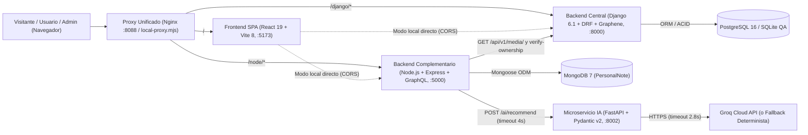
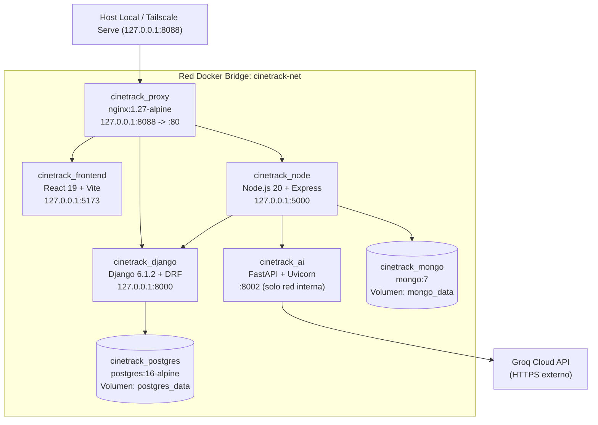
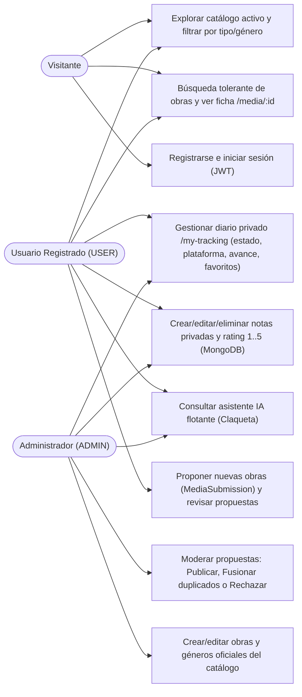
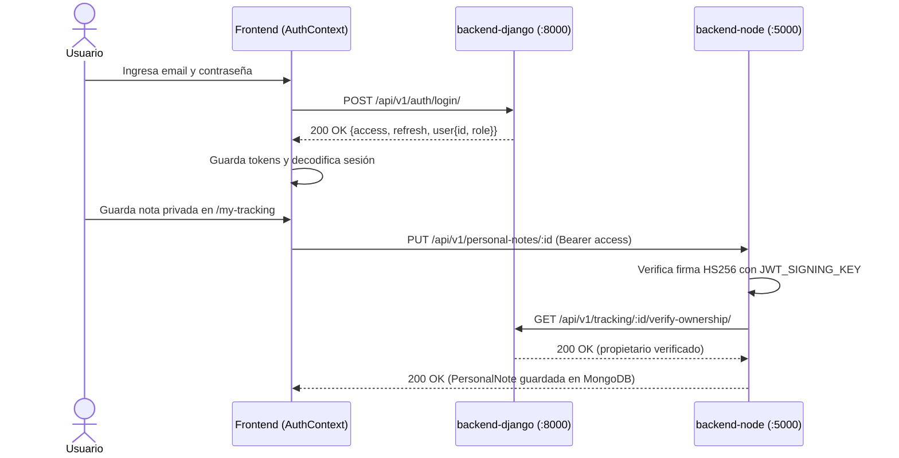
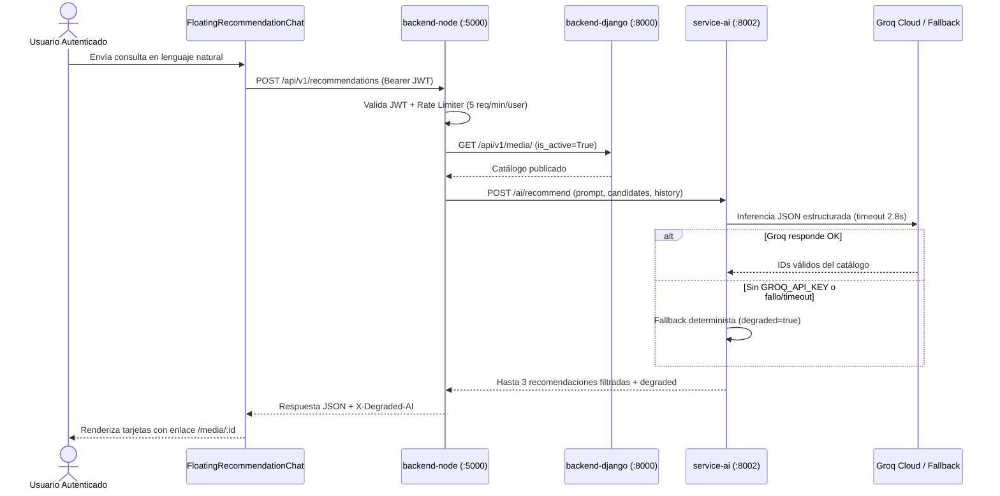
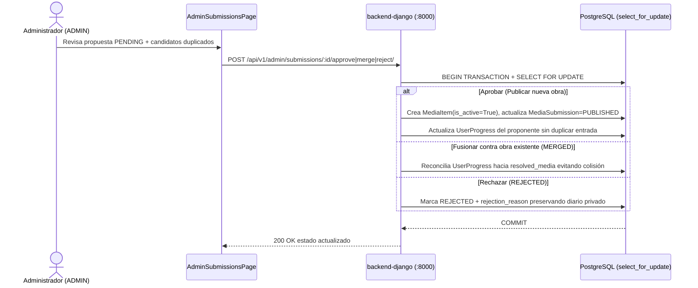
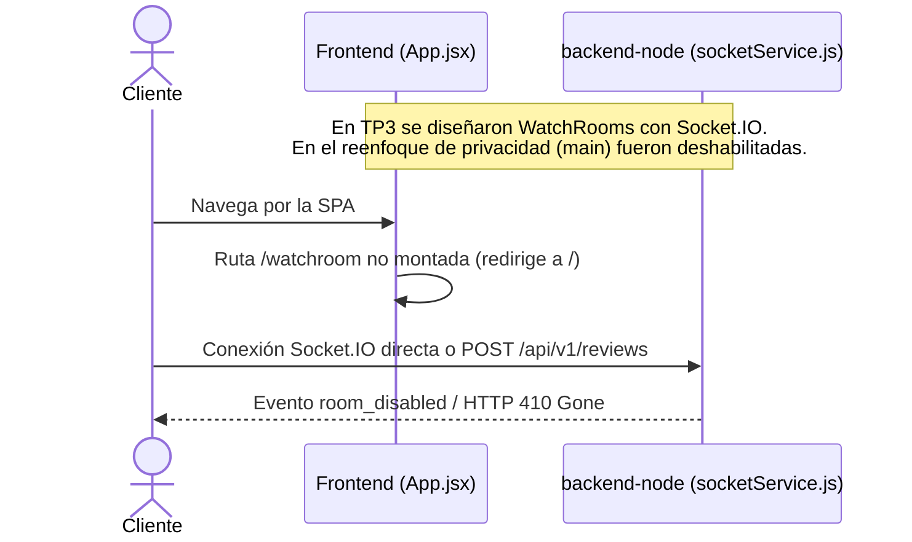
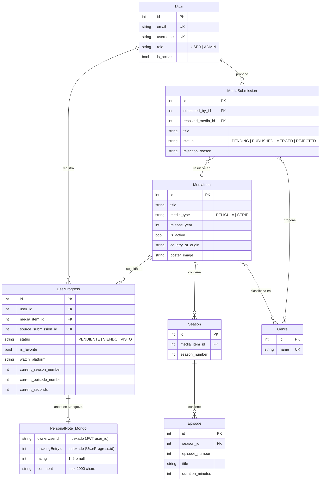
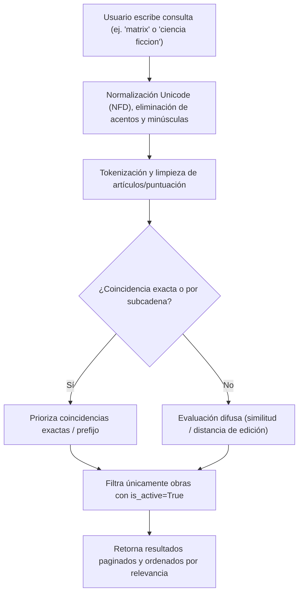
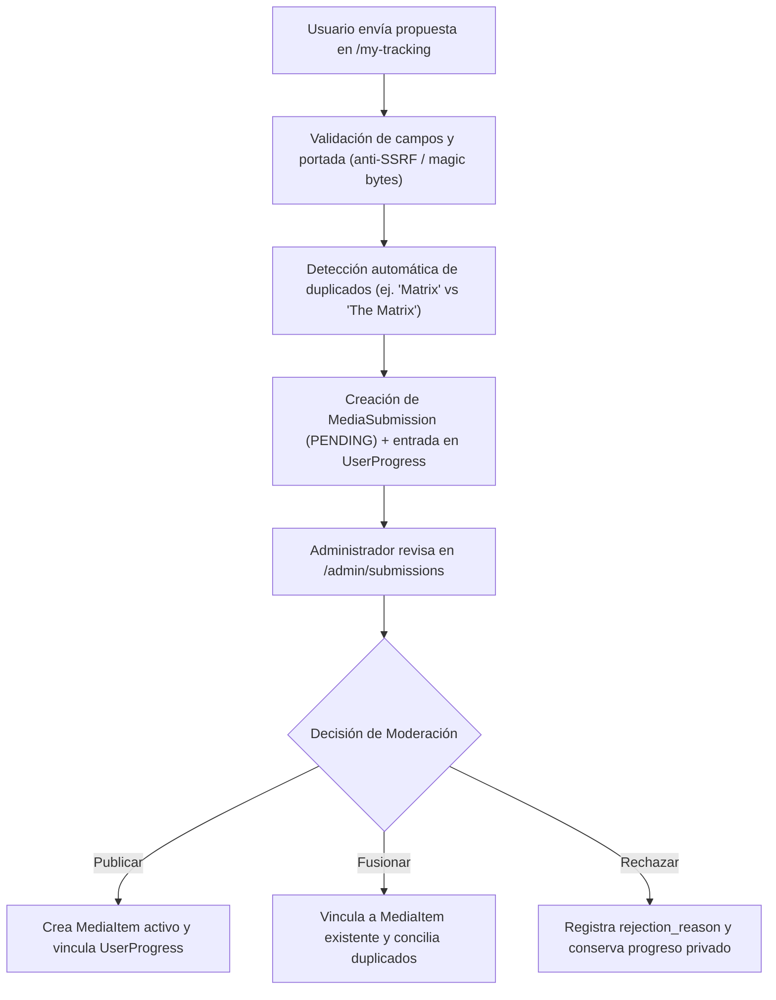

# CineTrack — Diagramas UML, Arquitectura y Flujos de Proceso

Todos los diagramas de este documento están escritos en sintaxis **Mermaid** válida y reflejan fielmente los componentes, modelos, rutas y flujos reales de la rama `main`.

---

## 1. Diagrama de Arquitectura / Componentes (Microservicios)

---

## 2. Diagrama de Despliegue (Contenedores Docker + Red Interna)

---

## 3. Diagrama de Casos de Uso

---

## 4. Diagramas de Secuencia

### 4.1 Autenticación JWT Centralizada y Consumo Desacoplado

### 4.2 Recomendación IA con Claqueta Flotante y Fallback

### 4.3 Moderación Transaccional de Propuestas (`PUBLISHED` / `MERGED` / `REJECTED`)

### 4.4 Estado de WatchRooms en Tiempo Real (Heredado / Deshabilitado en `main`)

---

## 5. Diagrama Entidad-Relación y Colección Documental

---

## 6. Diagramas de Flujo de Procesos Clave

### 6.1 Flujo de Búsqueda Tolerante (`catalog/search.py` & `textSearch.js`)

### 6.2 Flujo de Aprobación y Conciliación de Propuestas (`MediaSubmission`)

