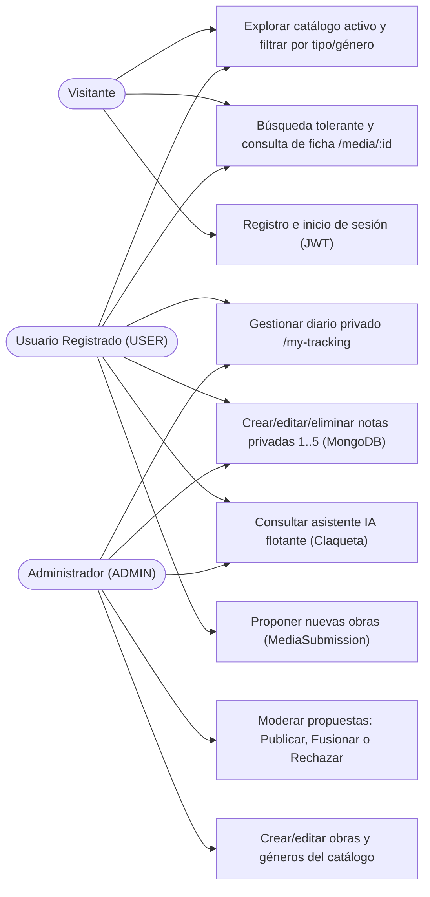
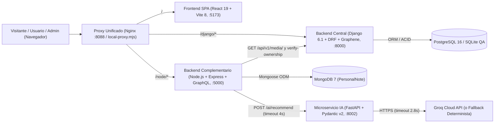
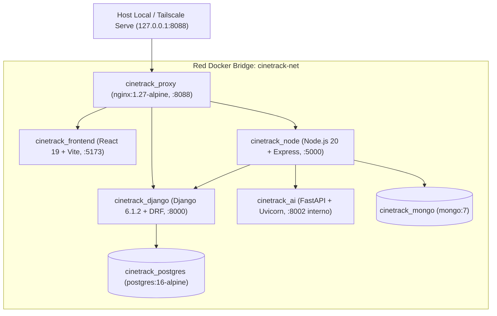
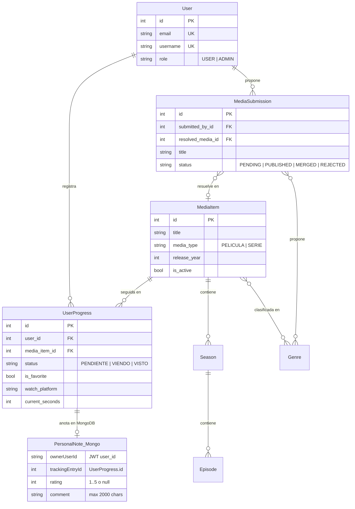
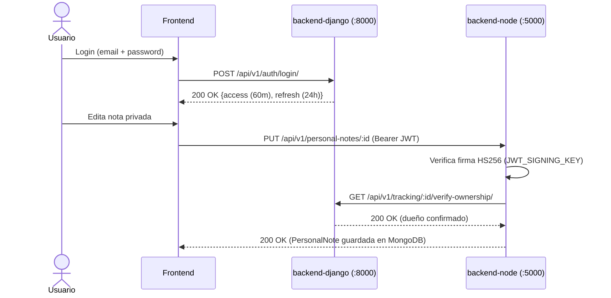
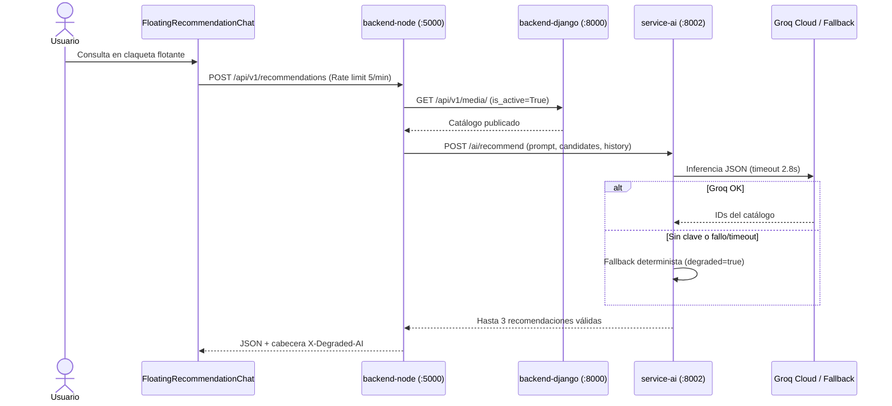
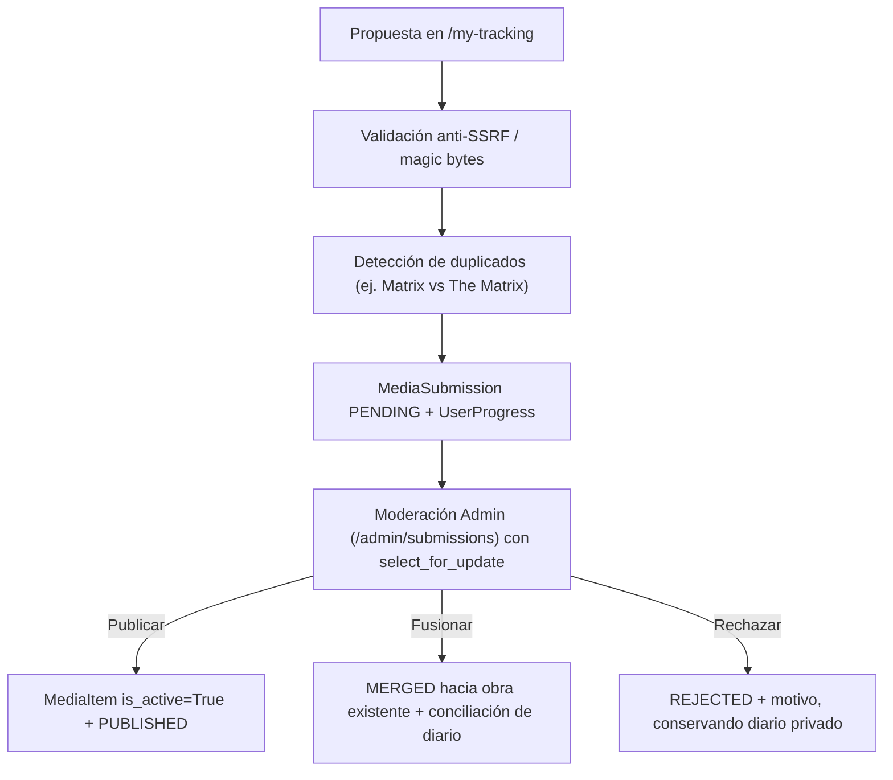

# Informe Final Integral — CineTrack (TP0–TP5)

**Asignatura:** Programación IV (Plan 2024)  
**Institución:** Universidad Tecnológica Nacional — Facultad Regional Resistencia (Extensión Áulica Goya)  
**Proyecto:** CineTrack / CineTracker — Plataforma Full-Stack de Seguimiento, Catálogo y Recomendación Audiovisual  
**Repositorio:** `https://github.com/BorghiEsteff/TPI-ProgIV` (rama `main`)  
**Fecha de consolidación:** 25 de noviembre de 2026

---

## 1. Resumen Ejecutivo

**CineTrack** es una plataforma web full-stack diseñada bajo una **arquitectura políglota de microservicios contenerizados** para resolver tres necesidades concretas del consumo audiovisual moderno:

1. **Catálogo unificado y curado:** Búsqueda tolerante a errores tipográficos y acentos sobre películas y series (`PELICULA` / `SERIE`), con jerarquía de temporadas y episodios.
2. **Diario personal privado (`Mi CineTrack`):** Seguimiento granular de estado (`PENDIENTE`, `VIENDO`, `VISTO`), plataforma, favoritos, progreso exacto (`current_seconds`) y notas privadas (`PersonalNote` en MongoDB con calificación `1..5`).
3. **Curaduría comunitaria e Inteligencia Artificial segura:** Sistema de propuestas (`MediaSubmission`) con detección automática de duplicados, moderación administrativa transaccional y un asistente conversacional flotante (`FloatingRecommendationChat`) que recomienda exclusivamente obras publicadas en el catálogo.

El proyecto cumple íntegramente los hitos **TP0 a TP5**, cuenta con **7 servicios orquestados en `docker-compose.yml`**, contratos **OpenAPI 3.0** y **GraphQL**, y una cobertura de pruebas automatizadas verificada en verde (**29 tests Django** en SQLite y PostgreSQL 16, **25 tests Node.js**, **9 tests FastAPI IA**, **24 tests Vitest** y **22/22 specs Playwright E2E** tanto en desktop como en móvil).

---

## 2. Alcance, Actores y Funcionalidades

### 2.1 Actores del Sistema



### 2.2 Decisiones de Evolución de Alcance (As-Built)
* **Simplificación RBAC (`USER` / `ADMIN`):** La migración `users/0002_migrate_critic_to_user.py` consolidó el antiguo rol `CRITIC` dentro de `USER`. El registro fuerza `role='USER'` e impide escaladas de privilegios.
* **Privacidad del diario:** Las reseñas públicas (`/api/v1/reviews`) fueron retiradas devolviendo `410 Gone`, y las salas `WatchRooms` (`Socket.IO`) fueron deshabilitadas en `backend-node` y removidas de `App.jsx`, dando lugar a `PersonalNote` privado en MongoDB.
* **IA Resiliente:** Se migró de Ollama local a **Groq Cloud API** con un **fallback determinista** (`degraded: true`) cuando no hay `GROQ_API_KEY` o ante fallos/timeouts, manteniendo revalidación estricta contra el catálogo activo (`is_active=True`).

---

## 3. Desarrollo Detallado de Trabajos Prácticos (TP0–TP5)

| Hito / TP | Objetivo Principal | Implementación en `main` | Evidencia Verificada |
| :--- | :--- | :--- | :--- |
| **TP0 — Propuesta** | Definir problemática, mapa tecnológico y arquitectura distribuida | Plataforma políglota en 4 módulos (`backend-django`, `backend-node`, `service-ai`, `frontend`) | `docs/tp-0-propuesta/PROPUESTA.md`, `PRODUCT.md` |
| **TP1 — CRUD y Persistencia** | Persistencia relacional ACID + documental NoSQL | `MediaItem`, `Genre`, `Season`, `Episode`, `UserProgress` en PostgreSQL/SQLite; `PersonalNote` en MongoDB | `backend-django/catalog/`, `tracking/`, `PersonalNote.js` |
| **TP2 — Seguridad y JWT** | Emisión centralizada JWT, verificación desacoplada y RBAC | SimpleJWT HS256 (`JWT_SIGNING_KEY`), `authMiddleware.js` en Node, anti-escalada, anti-SSRF/SVG en portadas | `users/serializers.py`, `authMiddleware.js`, `catalog/utils.py` |
| **TP3 — IA y Tiempo Real** | Microservicio FastAPI y experiencia interactiva | `service-ai` (`POST /ai/recommend`) con Groq + fallback; claqueta flotante React; WatchRooms retirado | `service-ai/main.py`, `FloatingRecommendationChat.jsx` |
| **TP4 — Contenedores y CI** | OpenAPI, GraphQL, Dockerfiles, Compose y CI | OpenAPI (`drf-spectacular` + Node), GraphQL (`allMediaItems`, `publicMediaDetails`), `docker-compose.yml` (7 servicios) y GitHub Actions en verde | `openapi-django.json`, `openapi.json`, `.github/workflows/ci.yml` |
| **TP5 — Informe Final y QA** | Consolidación documental, benchmarks, E2E y defensa | Suites unitarias, integración, E2E Playwright, benchmark SQL (`Index Scan`) y documentación integral | `docs/qa/ACTA_VALIDACION_FINAL.md`, `Documentacion/` |

---

## 4. Arquitectura Técnica y Construcción

### 4.1 Diagrama de Arquitectura de Microservicios



### 4.2 Diagrama de Despliegue (Docker Compose)



### 4.3 Stack Tecnológico Exacto

| Componente | Tecnología y Versiones Verificadas | Responsabilidad |
| :--- | :--- | :--- |
| **`backend-django/`** | Python 3.12+ (3.14.7), Django `6.1.2`, DRF `>=3.15.0`, SimpleJWT `>=5.3.0`, `drf-spectacular >=0.27.1`, `graphene-django >=3.2.0`, `psycopg2-binary >=2.9.9` | Identidad/RBAC, catálogo público, búsqueda tolerante, seguimiento privado, moderación de propuestas, REST + GraphQL + OpenAPI |
| **`backend-node/`** | Node.js 20+ (v24.16.0), Express `^4.19.2`, Mongoose `^8.3.0`, `jsonwebtoken ^9.0.2`, `zod ^3.22.4`, `axios ^1.6.8`, `helmet ^7.1.0`, `express-rate-limit ^7.2.0`, `express-graphql ^0.12.0` | Verificación JWT desacoplada, notas privadas (`PersonalNote`), GraphQL `publicMediaDetails`, proxy resiliente hacia `service-ai` |
| **`service-ai/`** | FastAPI `>=0.110.0`, Pydantic `>=2.6.4`, `httpx >=0.27.0`, `groq >=0.9.0`, Uvicorn `>=0.28.0` | Recomendaciones IA sobre catálogo publicado (`POST /ai/recommend`) con protección anti-prompt-injection y fallback determinista |
| **`frontend/`** | React `^19.3.1`, Vite `^8.3.6`, React Router `^7.18.5`, Bootstrap `^5.3.9`, Axios `^1.21.1`, Vitest `^5.1.0`, Playwright `^1.65.1` | SPA responsiva (desktop/tablet/móvil), diario unificado, moderación admin, claqueta flotante IA |
| **`proxy/` & `scripts/`** | Nginx `1.27-alpine`, `local-proxy.mjs`, scripts PowerShell Tailscale | Proxy único `:8088` y exposición privada multi-dispositivo vía Tailscale Serve |

### 4.4 Modelado de Datos Políglota (SQL + MongoDB)



---

## 5. Flujos Críticos y Secuencias de Operación

### 5.1 Autenticación JWT y Verificación *Fail-Closed*



### 5.2 Recomendaciones IA con Protección Anti-Alucinación



### 5.3 Flujo de Moderación y Conciliación de Propuestas



---

## 6. Tablero Kanban y Estado de Entrega

| Estado | Elementos Principales |
| :--- | :--- |
| **Completado (Done)** | TP0 (Propuesta), TP1 (SQL + MongoDB), TP2 (JWT + RBAC + anti-SSRF), TP3 (`service-ai` Groq + fallback + Claqueta), TP4 (OpenAPI, GraphQL, Docker Compose 7 servicios, CI verde), TP5 (Suites Pytest/Jest/Vitest/Playwright, Benchmark SQL, Documentación Integral y PDF). |
| **En Revisión / QA** | Validación final del PDF compilado (`INFORME_FINAL_CINETRACK.pdf`) y ensayo de defensa oral. |
| **Por Hacer (Externo)** | Activar *Branch Protection* en GitHub `Settings > Branches` para `main`. |
| **Fuera de Alcance (`main`)** | WatchRooms Socket.IO (deshabilitado), reseñas públicas (`410 Gone`), rol `CRITIC` (migrado a `USER`), Ollama local. |

---

## 7. Resumen de QA, Benchmarks y Reproducibilidad

### 7.1 Resultados de Pruebas Automatizadas (Acta 19/11/2026)

| Suite | Comando | Resultado Real |
| :--- | :--- | :--- |
| **Backend Django (SQLite & PG16)** | `pytest -v` | **29 passed** en ambos motores (0 fallos) |
| **Microservicio IA (`service-ai`)** | `pytest -v` | **9 passed** + prueba live Groq (`degraded: false`) |
| **Backend Node.js (`backend-node`)** | `npm test` | **6 suites, 25 passed** (Jest + Supertest) |
| **Frontend Unit + Build** | `npm test` & `npm run build` | **7 archivos, 24 passed**; build Vite `438` módulos |
| **Playwright E2E** | `npm run test:e2e` | **22/22 desktop** + **22/22 mobile** (aislando BD QA) |
| **Benchmark SQL** | `manage.py benchmark_queries` | SQLite QA: `13.59 ms` / `2.19 ms`; PG16: `Index Scan` (0 N+1) |

### 7.2 Puesta en Marcha Rápida con Docker Compose

```bash
git clone https://github.com/BorghiEsteff/TPI-ProgIV.git
cd TPI-ProgIV
cp .env.example .env
docker compose up --build -d
docker compose exec django-backend python manage.py migrate
docker compose exec django-backend python manage.py seed_data
```

Credenciales de demostración (`seed_data`):
* **Admin:** `admin@cinetrack.local` / `AdminPassword123!` (`ADMIN`)
* **Usuario:** `user@cinetrack.local` / `UserPassword123!` (`USER`)

---

## 8. Guía Resumida de Presentación (Defensa Oral de 8 Minutos)

1. **Min 0–1 (Problema y Solución):** Diario audiovisual privado con curaduría moderada e IA sin alucinaciones.
2. **Min 1–3 (Arquitectura y Seguridad):** Separación PostgreSQL/Django (ACID + identidad) vs MongoDB/Node (notas privadas + rate-limit) vs FastAPI/Groq (IA + fallback). JWT HS256 compartido y verificación *fail-closed*.
3. **Min 3–6 (Demo en Vivo):** Catálogo + búsqueda tolerante → Login `USER` → Diario privado + Nota MongoDB → Claqueta flotante IA → Propuesta y moderación `ADMIN` en `/admin/submissions`.
4. **Min 6–8 (QA y Conclusiones):** Cobertura de 29+25+9+24 tests unitarios/integración, 44 casos E2E Playwright, Docker Compose de 7 servicios y lecciones aprendidas.
