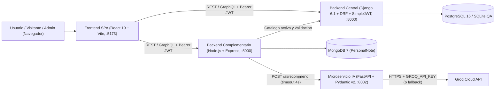
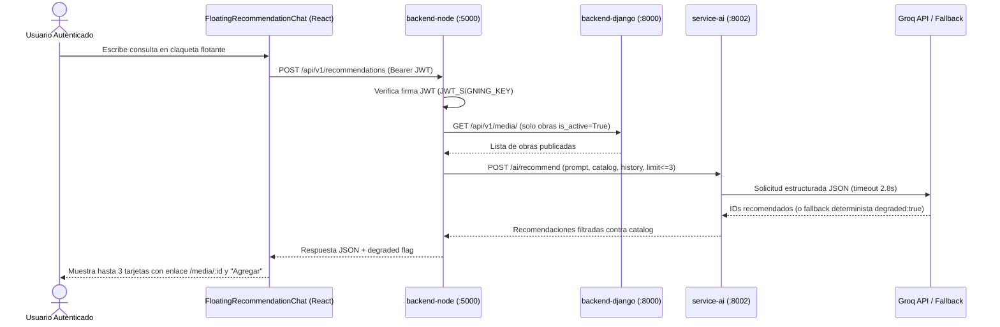
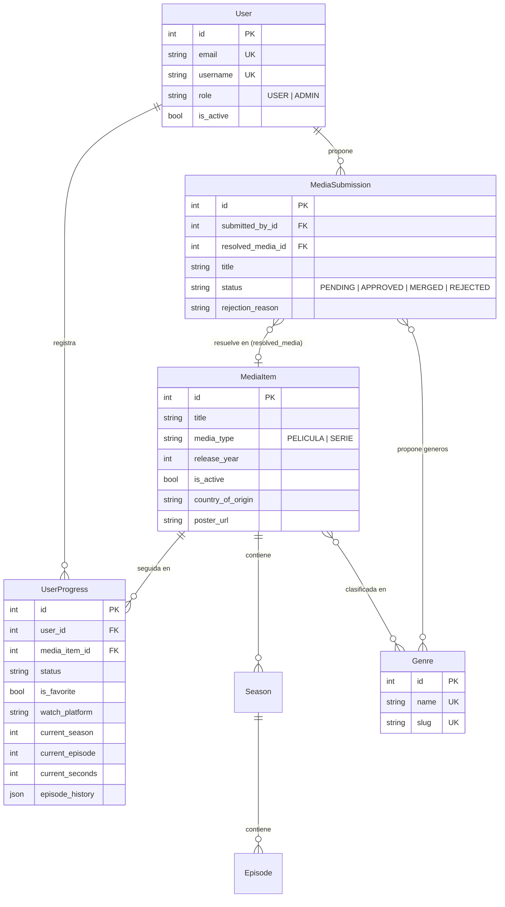

# CineTracker / CineTrack — Arquitectura As-Built, Modelado y Decisiones de Alcance

Documento de referencia técnica y académica alineado al estado real del código en `main`.

---

## 1. Justificación formal de decisiones de alcance y arquitectura

### 1.1 Simplificación de RBAC: de 3 roles (`USER`, `CRITIC`, `ADMIN`) a 2 roles (`USER`, `ADMIN`)
* **Contexto original (TP0/TP2):** se contempló un rol `CRITIC` para reseñas destacadas.
* **Implementación vigente:** `backend-django/users/models.py` y la migración `users/0002_migrate_critic_to_user.py` consolidaron los roles efectivos en **`USER`** y **`ADMIN`**. El serializer de registro (`users/serializers.py`) fuerza `role='USER'` como solo lectura e ignora cualquier intento de escalada en registro o `PATCH /api/v1/auth/me/`.
* **Justificación:** al reenfocar CineTracker hacia un diario personal privado con curaduría comunitaria moderada por administradores, un tercer rol intermedio generaba superficie de permisos sin funcionalidad exclusiva activa. La diferenciación real de acceso queda cubierta por `Visitante` (no autenticado, solo lectura pública), `USER` (diario privado, notas privadas, propuestas y recomendaciones IA) y `ADMIN` (publicación, fusión de duplicados, rechazo y edición de catálogo).

### 1.2 Retiro de reseñas públicas y WatchRooms en tiempo real; reemplazo por notas privadas
* **Contexto original (TP1/TP3):** `backend-node` incluía endpoints de reseñas públicas (`/api/v1/reviews`) y salas sincronizadas con Socket.IO (`WatchRooms`).
* **Implementación vigente:**
  * `backend-node/src/controllers/reviewController.js` y rutas asociadas responden **`410 Gone`** indicando la transición hacia diario privado.
  * `backend-node/src/services/socketService.js` notifica función deshabilitada y `frontend/src/App.jsx` no expone rutas de WatchRooms ni reseñas públicas.
  * La persistencia en MongoDB (`backend-node/src/models/PersonalNote.js`) se especializó en **notas personales privadas y calificación `1..5`**, aisladas por `userId` (`owner`).
* **Justificación:** evita problemas de moderación de contenido social abierto, protege la privacidad del diario personal (ningún usuario ni `ADMIN` puede leer notas privadas ajenas) y mantiene la arquitectura políglota justificada entre SQL (transaccional/relacional) y MongoDB (documentos privados flexibles).

### 1.3 Cambio de proveedor IA: de Ollama local a Groq Cloud + fallback determinista
* **Contexto original (TP3):** se propuso inferencia local con Ollama (`llama3.2:1b`) y análisis de spoilers (`/ai/review-guard`).
* **Implementación vigente:** `service-ai/main.py` expone `POST /ai/recommend` apoyado en **Groq Cloud API** (el código en `service-ai/services/recommender.py` define `DEFAULT_GROQ_MODEL = "openai/gpt-oss-20b"`, mientras que `docker-compose.yml` inyecta `GROQ_MODEL=${GROQ_MODEL:-llama-3.1-8b-instant}` cuando no se define en `.env`, con timeout de `2.8s`) y un **motor determinista de respaldo** (`degraded: true`) cuando falta `GROQ_API_KEY` o la API externa falla / responde JSON inválido. Además, soporta historial conversacional acotado, protección contra *prompt injection* y filtrado estricto por catálogo publicado (`is_active=True`). El antiguo endpoint `/ai/review-guard` fue retirado junto con las reseñas públicas.

> **Estado de ramas especializadas:** las ramas `frontend`, `backend-node` y `backend-django` conservan instantáneas selectivas de su ámbito (ver tabla en `CUMPLIMIENTO_TP0_TP5.md`), manteniendo `main` como referencia integradora única.
* **Justificación:** Ollama requiere GPU/RAM local elevada y descarga previa de pesos de varios GB, lo que dificulta la portabilidad en CI/CD y evaluación académica. Groq ofrece latencia baja con capa gratuita, mientras que el fallback determinista garantiza disponibilidad 100 % sin clave ni conexión externa, y la revalidación de IDs en `service-ai` y `backend-node` impide alucinaciones fuera del catálogo publicado (`is_active=True`).

---

## 2. Arquitectura C4 (Contexto, Contenedores y Flujo de Secuencia)

### 2.1 Diagrama de Contenedores (C4 Nivel 2)

### 2.2 Flujo de Secuencia: Recomendación IA con Claqueta Flotante

---

## 3. Modelado de Datos Actualizado (DER + MongoDB)

### 3.1 Esquema Relacional (`backend-django`)

### 3.2 Esquema Documental (`backend-node` / MongoDB 7)

Colección `personalnotes` (`backend-node/src/models/PersonalNote.js`):
* `userId` (`Number`, requerido, indexado): ID del usuario autenticado proveniente del claim `user_id` del JWT de Django.
* `mediaId` (`Number`, requerido, indexado): ID de `MediaItem` en Django.
* Índice compuesto único `{ userId: 1, mediaId: 1 }`: garantiza una nota privada por usuario y obra.
* `rating` (`Number`, entero `1..5`, opcional).
* `notes` (`String`, máximo 2000 caracteres).
* `createdAt`, `updatedAt` (`Date`, timestamps automáticos).

---

## 4. Casos de Uso por Actor Actual

* **Visitante (no autenticado):** explora el catálogo público (`is_active=True`), busca por título, filtra por tipo (`PELICULA`/`SERIE`) y género, y consulta fichas públicas (`/media/:id`). No posee rol persistido; cualquier acceso a diario, notas, propuestas, IA o moderación devuelve `401` o redirige a `/login`.
* **Usuario (`USER`):** todo lo del visitante + gestiona su diario privado unificado en `/my-tracking` (`UserProgress`: plataforma, estado, temporada/episodio/segundos, favoritos, conciliación de duplicados, propuestas pendientes y alta de obras), crea/edita/elimina sus notas privadas (`PersonalNote`) y consulta el asistente IA mediante la claqueta flotante (`FloatingRecommendationChat`).
* **Administrador (`ADMIN`):** todo lo de `USER` + accede a `/admin/submissions`, aprueba y publica propuestas nuevas, fusiona propuestas duplicadas contra obras existentes preservando diarios privados (`reconciliations`/`reconcile`), rechaza propuestas con motivo y crea/edita obras y géneros en el catálogo oficial.

---

## 5. Política de Seguridad, JWT y Auditoría Técnica

* **Emisión y verificación JWT:** `backend-django` emite tokens HS256 con `SimpleJWT` (`JWT_SIGNING_KEY`) incluyendo `user_id` y `role`. `backend-node` verifica firma y expiración con la misma clave compartida sin consultar a Django en cada petición.
* **Limitación conocida (revocación de roles):** si un administrador cambia el rol o desactiva un usuario en Django, `backend-node` confiará en el claim `role` del access token hasta su expiración natural. Mitigación vigente: vida corta del access token (configuración SimpleJWT) y verificación directa contra BD en Django para todas las operaciones de moderación/catálogo.
* **Protección de endpoints y datos:**
  * Anti-escalada de privilegios en `/api/v1/auth/register/` y `/api/v1/auth/me/`.
  * Aislamiento estricto por `userId` en `UserProgress` y `PersonalNote` (prevención de IDOR horizontal).
  * Validación de portadas y anti-SSRF/SVG en `backend-django/catalog/utils.py`.
  * CORS restringido por `CORS_ALLOWED_ORIGINS` (Django) y `CLIENT_ORIGIN` (Express y Socket.IO en `backend-node/src/server.js`).
  * Endpoints retirados (`/api/v1/reviews`) bloqueados con `410 Gone`.
