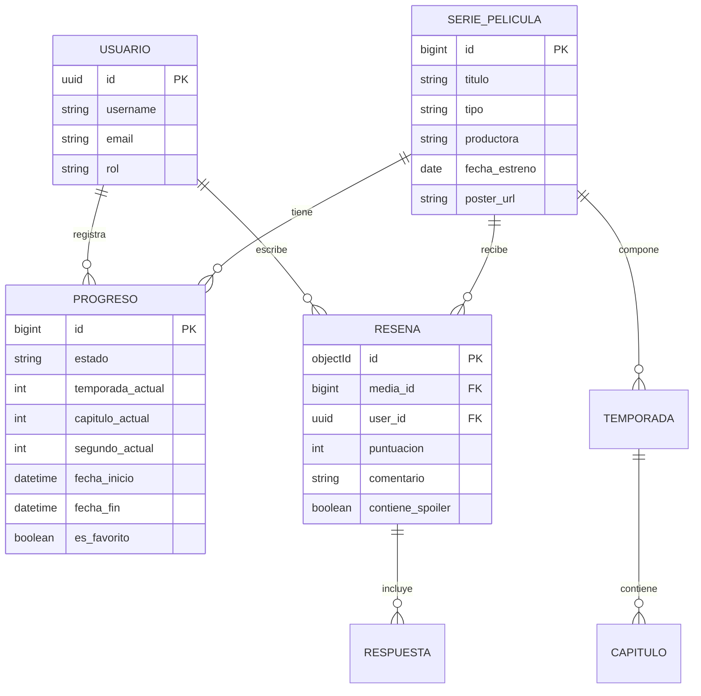

# PROPUESTA DE TRABAJO PRÁCTICO INTEGRADOR

**Asignatura:** Programación IV (Plan 2024)  
**Institución:** Universidad Tecnológica Nacional – Facultad Regional Resistencia (Extensión Áulica Goya)  
**Docentes:** Ing. Juan Manuel Goya (Línea Python) · Prof. Gerardo Ramírez (Línea JavaScript)  
**Proyecto:** CineTrack – Plataforma de Gestión, Seguimiento Granular y Comunidad de Series y Películas  

---

## 1. Problema y Usuarios Objetivo
El seguimiento de contenidos audiovisuales se encuentra fragmentado entre múltiples servicios. Los espectadores frecuentes pierden el registro de en qué temporada, capítulo y minuto exacto interrumpieron una serie, y carecen de métricas sobre cuándo comenzaron o concluyeron un título. Por otro lado, las comunidades de debate suelen exponer a los usuarios a spoilers imprevistos.

**Perfiles de Usuario:**
- **Espectador:** Necesita registrar su progreso exacto, organizar su lista de pendientes y consultar recomendaciones libres de spoilers.
- **Crítico Comunitario:** Valora contenidos del 1 al 10, publica reseñas detalladas e interactúa con otros usuarios mediante respuestas anidadas.
- **Administrador:** Da de alta y mantiene la consistencia del catálogo canónico de series, temporadas y capítulos.

---

## 2. Backlog Priorizado (MoSCoW)

- **Must Have (Obligatorio MVP):**
  1. Catálogo de series y películas con foto, productora, fecha de estreno y géneros.
  2. Estructura de series organizada por temporadas y capítulos.
  3. Registro granular de progreso: temporada, capítulo y segundo exacto de visualización.
  4. Registro automático de fecha de inicio y finalización de cada contenido.
  5. Búsqueda por texto y filtros combinados (géneros, estado de visualización, favoritos).
  6. Sistema de valoraciones (1-10) y reseñas con respuestas anidadas.
  7. Autenticación y autorización por JWT compartido entre ambos backends.

- **Should Have:**
  8. Detección automatizada de spoilers en reseñas mediante microservicio de IA.
  9. Salas en tiempo real (WatchRooms) con indicador de presencia vía WebSockets.

- **Could Have:**
  10. Recomendaciones semánticas según historial de visualización.

- **Won't Have (Fuera de Alcance Vinculante):**
  - Reproducción o streaming de video dentro de la aplicación.
  - Pasarelas de cobro de suscripciones.
  - Sincronización o scraping en vivo desde plataformas comerciales externas (Netflix, Prime, Max).

---

## 3. Modelo de Dominio Preliminar

---

## 4. Gestión de Riesgos y Mitigación

1. **Riesgo:** Sobrecarga o lentitud en la ejecución del modelo de IA en las máquinas del aula durante la corrección.
   - **Mitigación:** Empleo de Ollama con un modelo ultraliviano de 1B parámetros (`llama3.2:1b`), control de timeout (4 segundos) y respuesta por contingencia (fallback).

2. **Riesgo:** Desincronización en la validación de tokens JWT entre Django y Express.
   - **Mitigación:** Django actúa como emisor único de tokens; Express solo valida la firma con la clave secreta compartida sin consultar la base de datos relacional.

3. **Riesgo:** Falla de red en la integración entre el backend de Node y el de Django.
   - **Mitigación:** Cliente Axios con timeout de 2.5s y respuesta degradada (`X-Degraded-Mode: true`), permitiendo cargar reseñas de MongoDB aunque Django no responda.
