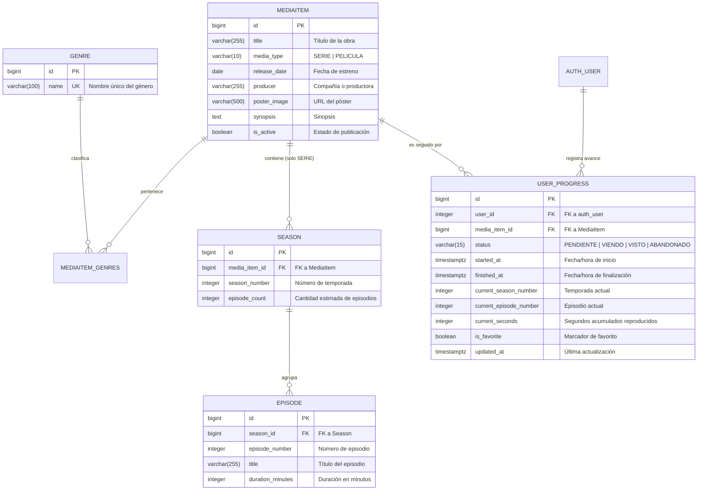

# TP 1: Modelado de Dominio y Persistencia Relacional en PostgreSQL 16

## 1. Diagrama Entidad-Relación (DER) y Estructura Relacional

El núcleo transaccional de **CineTrack** reside en PostgreSQL 16 dentro de la aplicación Django (`catalog` y `tracking`). A continuación se detallan las entidades implementadas, tipos de datos, relaciones de cardinalidad y restricciones de integridad.

---

## 2. Restricciones de Integridad y Llaves Foráneas

1. **`catalog_genre`**:
   - `name`: Índice único (`UNIQUE`). Evita duplicación de categorías semánticas.

2. **`catalog_mediaitem`**:
   - Relación Many-to-Many con `catalog_genre` a través de tabla intermedia `catalog_mediaitem_genres` con claves primarias compuestas e índices optimizados para filtrado por género.
   - Índice sobre `release_date` y `title` para optimizar ordenamientos frecuentes.

3. **`catalog_season`**:
   - `media_item_id`: Llave foránea (`ON DELETE CASCADE`) hacia `catalog_mediaitem`.
   - Restricción: `unique_together = ('media_item', 'season_number')`. Impide que una misma serie tenga dos temporadas con el mismo número secuencial.
   - Validación de Modelo y Serializer: Solo ítems con `media_type = 'SERIE'` pueden asociar registros en esta tabla.

4. **`catalog_episode`**:
   - `season_id`: Llave foránea (`ON DELETE CASCADE`) hacia `catalog_season`.
   - Restricción: `unique_together = ('season', 'episode_number')`. Garantiza la unicidad del número de episodio dentro de la temporada.

5. **`tracking_userprogress`**:
   - `user_id`: Llave foránea hacia `auth_user`.
   - `media_item_id`: Llave foránea hacia `catalog_mediaitem`.
   - Restricción: `unique_together = ('user', 'media_item')`. Cada usuario tiene un único registro de progreso por contenido multimedia, evitando colisiones o desincronizaciones de estado.

---

## 3. Justificaciones Técnicas de Arquitectura y Negocio

### A. Almacenamiento del Tracking en Segundos Acumulados (`current_seconds`)
- **Precisión Atómica:** Representar el progreso temporal en un entero positivo de segundos (`PositiveIntegerField`) elimina problemas de redondeo, discrepancias de formato (ej. `HH:MM:SS`) y zonas horarias.
- **Interoperabilidad con Reproductores Web/Móvil:** Las APIs HTML5 de video (como `HTMLMediaElement.currentTime`) entregan el tiempo reproducido en segundos de punto flotante. Almacenarlo como entero truncado/redondeado simplifica la persistencia mediante peticiones HTTP livianas (`PATCH`).
- **Compatibilidad con Series y Películas:** 
  - En una película, `current_seconds` representa la posición global exacta dentro del metraje.
  - En una serie, la tupla (`current_season_number`, `current_episode_number`, `current_seconds`) identifica unívocamente el instante exacto en el que el usuario pausó la reproducción dentro de un episodio específico.

### B. Jerarquía de Series vs. Películas (Enfoque Tabla Única con Relación Restringida)
- En lugar de fragmentar el modelo en dos jerarquías separadas (`Movie` y `Serie`), se implementó la entidad unificada `MediaItem` con un discriminador `media_type` (`SERIE` | `PELICULA`).
- **Ventajas:**
  - Permite búsquedas polimórficas eficientes en un solo endpoint (`/api/v1/media/`) con filtros unificados de catálogo, productora y géneros.
  - Facilita el seguimiento de favoritos y listas de pendientes en `tracking_userprogress` sin requerir relaciones genéricas (`GenericForeignKey`) que degradarían el rendimiento de los joins relacionales.
- **Integridad:** Las reglas de negocio en los serializers y métodos `clean()` de Django imponen que si un elemento es `PELICULA`, se rechace cualquier intento de creación o asociación de `Season` o `Episode`, garantizando la pureza semántica de los datos en base de datos.
