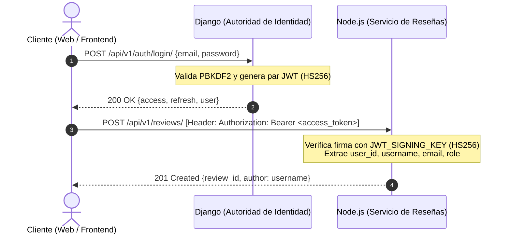

# TP 2: Contrato y Especificación de Seguridad Centralizada con SimpleJWT

## 1. Arquitectura de Identidad Centralizada (Single Source of Truth)

En la arquitectura de microservicios de **CineTrack**:
- **Django REST Framework (Servicio Central de Identidad):** Es la **única autoridad emisora** de credenciales y tokens JWT. Gestiona el registro de usuarios, almacenamiento seguro de credenciales con hashing salado y generación del par de tokens (`access` y `refresh`).
- **Node.js (Servicio Social de Reseñas):** Actúa como **consumidor y verificador descentralizado**. Valida criptográficamente el access token en cada petición entrante sin consultar a Django por cada request, gracias a la clave simétrica compartida `JWT_SIGNING_KEY`.
- **FastAPI / Ollama (Servicio de Inteligencia Artificial):** Consumirá el mismo token en fases posteriores para atribuir análisis de reseñas y recomendaciones al usuario emisor.



---

## 2. Especificación Técnica del Token JWT

### Parámetros Criptográficos
- **Algoritmo:** `HS256` (HMAC con SHA-256).
- **Clave Secreta Compartida:** `JWT_SIGNING_KEY` (definida en variables de entorno `.env` de Django y Node.js).
- **Vida Útil Access Token:** 60 minutos (`ACCESS_TOKEN_LIFETIME = timedelta(minutes=60)`).
- **Vida Útil Refresh Token:** 1 día (`REFRESH_TOKEN_LIFETIME = timedelta(days=1)`).

### Estructura del Payload del Access Token
El serializer [`CustomTokenObtainPairSerializer`](file:///c:/Proyecto-Programacion/TPI-ProgramacionIV/backend-django/users/serializers.py) enriquece el payload estándar con los siguientes claims:

```json
{
  "token_type": "access",
  "exp": 1730835000,
  "iat": 1730831400,
  "jti": "b1e459fa4f59451480f2d480cb70e28a",
  "user_id": 1,
  "username": "fan_series",
  "email": "user@cinetrack.local",
  "role": "USER"
}
```

### Tabla de Claims Canónicos

| Claim | Tipo | Descripción | Uso en Servicios Consumidores (Node / Frontend) |
| :--- | :--- | :--- | :--- |
| `token_type` | `string` | Tipo de token (`"access"`). | Validación de propósito. |
| `exp` | `number` (timestamp unix) | Expiración del token. | Verificación de validez temporal. |
| `user_id` | `integer` | ID numérico del usuario en la base relacional (PostgreSQL). | Asociación foránea del autor de la reseña en MongoDB (`user_id`). |
| `username` | `string` | Nombre legible para mostrar. | Presentación pública en comentarios y perfiles. |
| `email` | `string` | Correo electrónico único del usuario. | Identificación administrativa y notificaciones. |
| `role` | `string` | Rol asignado (`"ADMIN"`, `"CRITIC"`, `"USER"`). | Control de acceso basado en roles (RBAC). |

---

## 3. Instrucciones de Verificación para el Servicio Node.js

Para verificar el token en Express (middleware de autenticación a cargo de Ari):

```javascript
const jwt = require('jsonwebtoken');

function authenticateJWT(req, res, next) {
  const authHeader = req.headers.authorization;
  if (!authHeader || !authHeader.startsWith('Bearer ')) {
    return res.status(401).json({
      status_code: 401,
      error: 'Unauthorized',
      detail: 'Cabecera Authorization ausente o sin formato Bearer.'
    });
  }

  const token = authHeader.split(' ')[1];
  try {
    const payload = jwt.verify(token, process.env.JWT_SIGNING_KEY, {
      algorithms: ['HS256']
    });
    // Inyectar usuario extraído en el objeto request
    req.user = {
      id: payload.user_id,
      username: payload.username,
      email: payload.email,
      role: payload.role
    };
    next();
  } catch (err) {
    return res.status(401).json({
      status_code: 401,
      error: 'InvalidToken',
      detail: 'El token proporcionado es inválido o ha expirado.'
    });
  }
}
```

---

## 4. Endpoints Expuestos por Django

### A. Registro de Usuarios: `POST /api/v1/auth/register/`
- **Permisos:** Público (`AllowAny`).
- **Body:**
  ```json
  {
    "email": "nuevo@cinetrack.local",
    "username": "nuevo_usuario",
    "password": "PasswordFuerte123!",
    "password_confirm": "PasswordFuerte123!",
    "role": "USER",
    "bio": "Aficionado a la ciencia ficción."
  }
  ```
- **Respuesta 201 Created:**
  ```json
  {
    "message": "Usuario registrado exitosamente.",
    "user": {
      "id": 4,
      "email": "nuevo@cinetrack.local",
      "username": "nuevo_usuario",
      "role": "USER",
      "bio": "Aficionado a la ciencia ficción.",
      "created_at": "2026-11-05T15:50:00Z"
    }
  }
  ```

### B. Login / Emisión de Tokens: `POST /api/v1/auth/login/`
- **Permisos:** Público (`AllowAny`).
- **Body:**
  ```json
  {
    "email": "user@cinetrack.local",
    "password": "UserPassword123!"
  }
  ```
- **Respuesta 200 OK:**
  ```json
  {
    "access": "eyJhbGciOiJIUzI1NiIsInR5cCI6IkpXVCJ9...",
    "refresh": "eyJhbGciOiJIUzI1NiIsInR5cCI6IkpXVCJ9...",
    "user": {
      "id": 3,
      "username": "fan_series",
      "email": "user@cinetrack.local",
      "role": "USER",
      "bio": "Entusiasta de series de ciencia ficción..."
    }
  }
  ```

### C. Refresco de Access Token: `POST /api/v1/auth/token/refresh/`
- **Permisos:** Público (`AllowAny`).
- **Body:**
  ```json
  {
    "refresh": "<refresh_token>"
  }
  ```
- **Respuesta 200 OK:**
  ```json
  {
    "access": "<nuevo_access_token>"
  }
  ```

---

## 5. Checklist de Seguridad OWASP Aplicado

1. **A02:2021 - Fallas Criptográficas (Cryptographic Failures):**
   - Contraseñas procesadas mediante el algoritmo robusto por defecto de Django `PBKDF2` con hash `SHA-256`, 720.000 iteraciones y sal criptográfica única por usuario. Jamás se persisten o transmiten credenciales en texto plano.
   - Tokens firmados con HMAC-SHA256 (`HS256`) y clave secreta robusta compartida exclusivamente entre microservicios vía variables de entorno.
2. **A01:2021 - Pérdida de Control de Acceso (Broken Access Control):**
   - El endpoint `/api/v1/tracking/` implementa control de acceso a nivel de objeto mediante filtrado en `get_queryset()`: un usuario autenticado solo puede visualizar o mutar sus propios registros de progreso (`UserProgress.objects.filter(user=request.user)`).
   - El usuario asociado a cualquier creación o actualización se asigna en el servidor (`perform_create(user=request.user)`), bloqueando cualquier intento de suplantación de identidad (IDOR).
   - Permiso personalizado [`IsCriticOrAdmin`](file:///c:/Proyecto-Programacion/TPI-ProgramacionIV/backend-django/core/permissions.py) para endpoints administrativos y editoriales.
3. **A07:2021 - Fallas de Identificación y Autenticación:**
   - Caducidad forzada de tokens de corta duración (60 minutos para acceso).
   - Validación rigurosa de fortaleza de contraseñas mediante validadores de Django (longitud mínima de 8 caracteres, validación contra atributos de usuario y contraseñas comunes).

