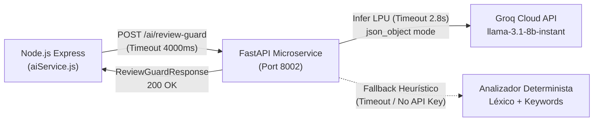

# TP 3: Microservicio de IA Semántica y Optimización de Consultas Relacionales

## 1. Arquitectura del Microservicio de IA (`service-ai/`)

Para la detección automatizada de spoilers y el análisis de polaridad emocional de las reseñas, se implementó un microservicio semántico independiente basado en **FastAPI**, **Pydantic v2** e inferencia ultrarrápida mediante **Groq Cloud LPU** (`llama-3.1-8b-instant`).



---

## 2. Contrato de Integración HTTP Canónico (`POST /ai/review-guard`)

### A. Endpoint Canónico
- **Ruta:** `POST http://localhost:8002/ai/review-guard` (o `http://service-ai:8002/ai/review-guard` en red Docker).
- **Puerto:** `8002`
- **Timeout del Consumidor (Node.js):** 4000 ms.
- **Timeout Interno con Groq:** 2.8 s (garantiza responder antes del corte de Node).

### B. Payload de Entrada (`ReviewGuardRequest`)
```json
{
  "comment": "Gran desarrollo de personajes pero el villano muere al final de la temporada.",
  "media_item_id": 1
}
```

### C. Esquema de Respuesta (`ReviewGuardResponse`)
```json
{
  "contains_spoiler": true,
  "confidence": 0.95,
  "sentiment": "POSITIVE"
}
```

---

## 3. Estrategia de Inferencia y Ahorro de Tokens en Groq LPU

1. **Recorte Preventivo de Entrada:** Todo comentario recibido es truncado a un máximo de **800 caracteres**, eliminando ruido sin comprometer el contexto argumental.
2. **System Prompt Compacto:**
   ```text
   Clasifica la reseña. Devuelve EXCLUSIVAMENTE este JSON:
   {"contains_spoiler": bool, "confidence": float (0.0-1.0), "sentiment": "POSITIVE"|"NEGATIVE"|"NEUTRAL"}
   ```
3. **Parámetros Deterministas:**
   - `temperature = 0.0`
   - `max_tokens = 80`
   - `response_format = {"type": "json_object"}`
4. **Circuito de Fallback Heurístico Determinista:**
   - Ante ausencia de `GROQ_API_KEY`, error de conexión, rate limit (HTTP 429) o demoras superiores a 2.8 segundos, el servicio activa inmediatamente su motor léxico local basado en un set de palabras clave críticas (`muere`, `final`, `asesino`, `traiciona`, `descubre que`, etc.) y polaridad por conteo léxico.
   - La respuesta se entrega en **< 5 ms**, con código `200 OK` y añadiendo la cabecera HTTP `X-Degraded-AI: true`, impidiendo que el flujo social del usuario se bloquee.

---

## 4. Optimización Relacional y Erradicación de N+1 en Django

En el marco de la escalabilidad requerida por la cátedra para el TP 3, se aplicaron las siguientes optimizaciones sobre PostgreSQL / Django:

### A. Creación de Índices Compuestos y Simples
- **`MediaItem`**:
  - Índices simples (`db_index=True`) en `title`, `media_type`, `release_date`, `producer` e `is_active`.
  - Índice compuesto: `media_type_active_idx` sobre `(media_type, is_active)` para acelerar filtros de catálogo.
  - Índice compuesto: `media_date_title_idx` sobre `(release_date, title)` para listados cronológicos.
- **`Season` & `Episode`**:
  - Índice compuesto `season_media_num_idx` sobre `(media_item, season_number)`.
  - Índice compuesto `ep_season_num_idx` sobre `(season, episode_number)`.
- **`UserProgress`**:
  - Índices compuestos: `prog_user_media_idx`, `prog_user_status_idx` y `prog_user_fav_idx` para consultas inmediatas por perfil y estado de seguimiento.

### B. Erradicación de Consultas N+1
- En `catalog/views.py`: `MediaItemViewSet` implementa `prefetch_related('genres', 'seasons__episodes')`, reduciendo consultas múltiples anidadas a únicamente 4 queries constantes en base de datos.
- En `tracking/views.py`: `UserProgressViewSet` implementa `select_related('media_item')`, recuperando la obra vinculada en un único `INNER JOIN`.

### C. Resultados del Benchmark (`python manage.py benchmark_queries`)
```text
=== Benchmark de Consultas e Índices en Django ===
[OK] Catálogo optimizado (prefetch_related): 3 ítems procesados en 17.14 ms con 4 consultas SQL.
[EXPLAIN Plan - MediaItem]:
4 0 60 SEARCH catalog_mediaitem USING INDEX media_type_active_idx (media_type=? AND is_active=?)
24 0 0 USE TEMP B-TREE FOR ORDER BY
[OK] Tracking optimizado (select_related): 1 registros en 1.72 ms con 1 consultas SQL (0 consultas N+1).
=== Benchmark completado exitosamente ===
```

