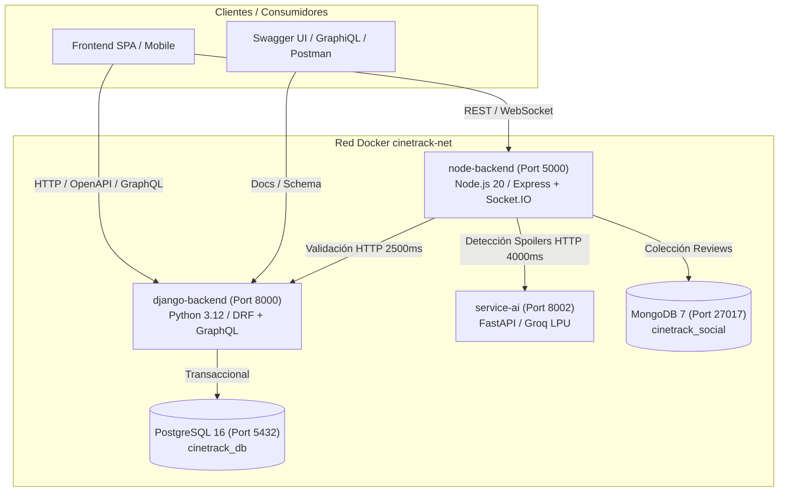

# TP 4: Contenedorización Multi-Servicio, OpenAPI 3.0 y Consultas GraphQL

## 1. Arquitectura de Despliegue en Contenedores (`Docker Compose`)

El sistema integral de **CineTrack** se encuentra completamente orquestado para ejecución en ambientes de desarrollo y producción mediante `docker-compose.yml`, interconectando cinco microservicios en una red virtual aislada `cinetrack-net`:



---

## 2. Buenas Prácticas de Contenedorización Implementadas

1. **Construcción Multi-Stage:**
   - Tanto `backend-node/Dockerfile` como `backend-django/Dockerfile` utilizan imágenes base ligeras (`alpine` y `slim`) dividiendo la etapa de compilación de librerías y dependencias de la imagen final de ejecución.
2. **Seguridad y Principio de Menor Privilegio (Non-Root Users):**
   - `node-backend`: Ejecuta bajo el usuario `node` (UID 1000).
   - `django-backend`: Crea y ejecuta bajo el usuario del sistema `appuser` (UID 1000).
   - `service-ai`: Crea y ejecuta bajo el usuario del sistema `aiuser` (UID 1001).
3. **Persistencia e Integridad:**
   - Volúmenes declarados con nombre (`postgres_data` y `mongo_data`) para preservar la base relacional y la base de documentos.
4. **Healthchecks y Dependencias Ordenadas:**
   - `pg_isready` en PostgreSQL y `mongosh ping` en Mongo garantizan que las aplicaciones inicien únicamente cuando las bases de datos estén listas para aceptar conexiones (`condition: service_healthy`).

---

## 3. Especificaciones OpenAPI 3.0 Desacopladas

Para garantizar total independencia entre microservicios y evitar colisiones de archivos:

- **Capa Social y Reseñas (Node.js):**
  - Documentada en [`docs/tp-4-contenedores-despliegue/openapi.json`](file:///c:/Proyecto-Programacion/TPI-ProgramacionIV/docs/tp-4-contenedores-despliegue/openapi.json).
  - Define las operaciones CRUD de reseñas, subdocumentos de respuestas y esquema de seguridad Bearer.
- **Identidad, Catálogo y Tracking (Django):**
  - Generada dinámicamente con `drf-spectacular` y exportada en [`docs/tp-4-contenedores-despliegue/openapi-django.json`](file:///c:/Proyecto-Programacion/TPI-ProgramacionIV/docs/tp-4-contenedores-despliegue/openapi-django.json).
  - Endpoints interactivos disponibles en ejecución:
    - `GET /api/schema/`: Especificación OpenAPI 3.0 en JSON/YAML.
    - `GET /api/docs/`: Interfaz interactiva Swagger UI.
    - `GET /api/redoc/`: Documentación visual en ReDoc.

---

## 4. Capa GraphQL y Consultas Federadas

### A. Endpoint GraphQL en Django: `POST /graphql/`
Implementado con `graphene-django` en [`backend-django/catalog/schema.py`](file:///c:/Proyecto-Programacion/TPI-ProgramacionIV/backend-django/catalog/schema.py):

```graphql
query ListCatalogAndItem($id: Int!) {
  allMediaItems(mediaType: "SERIE") {
    id
    title
    mediaType
    genres {
      name
    }
    seasons {
      seasonNumber
      episodeCount
    }
  }
  mediaItemById(id: $id) {
    id
    title
    producer
    synopsis
    releaseDate
  }
}
```

### B. Federación y Consumo Cruzado desde Node.js: `POST /graphql`
El backend de Node.js expone en su resolver `mediaDetailsWithReviews` una consulta híbrida que resuelve en un único viaje de red:
1. Valida y obtiene los datos del catálogo desde Django (`validateMediaExists`).
2. Agrega las reseñas y el árbol de comentarios desde MongoDB.
3. Calcula en tiempo de ejecución el promedio de calificación (`averageRating`) y el total de opiniones.

