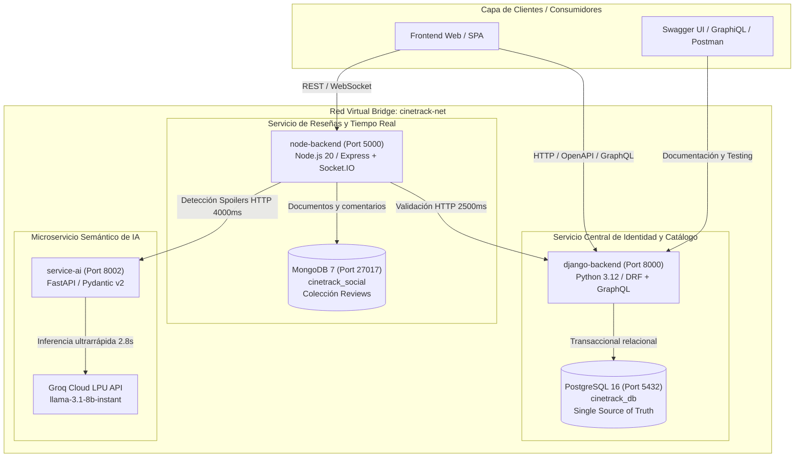

# CineTrack — Informe Técnico Integral (TP 5)
## Frente Tecnológico: Python, Django REST Framework, PostgreSQL 16, FastAPI, Groq LPU y DevOps
**Responsable:** Estefanía Borghi  
**Cátedra:** Programación IV (Plan 2024) - UTN Facultad Regional Resistencia (Extensión Áulica Goya)  
**Proyecto:** CineTrack (Plataforma Políglota de Seguimiento Multimedia y Capa Social)

---

## 1. Arquitectura del Sistema y Topología de Red

El proyecto **CineTrack** resuelve la disparidad de requisitos de una plataforma multimedia moderna mediante una **arquitectura políglota de microservicios contenerizados**. Cada componente se implementó con la tecnología más idónea para su dominio de persistencia y concurrencia.



### Topología de Red y Contenedores (`docker-compose.yml`)
Los 5 contenedores conviven en la red virtual bridge `cinetrack-net`:
1. `cinetrack_postgres`: PostgreSQL 16 Alpine (puerto 5432), volumen persistente `postgres_data` y healthcheck `pg_isready`.
2. `cinetrack_mongo`: MongoDB 7 (puerto 27017), volumen persistente `mongo_data` y healthcheck `mongosh ping`.
3. `cinetrack_django`: Django REST + Graphene GraphQL (puerto 8000), dependiente de que PostgreSQL esté saludable.
4. `cinetrack_node`: Express + Socket.IO + GraphQL (puerto 5000), dependiente de Mongo, Django y FastAPI.
5. `cinetrack_ai`: FastAPI + Groq LPU (puerto 8002), healthcheck en `/health`.

---

## 2. Frente TP 1: Persistencia Relacional y Modelo de Dominio

### 2.1 Modelo Entidad-Relación en PostgreSQL 16
Implementado en `backend-django/catalog/models.py` y `backend-django/tracking/models.py`:
- **`Genre`**: Nombre único (`unique=True`) para categorización taxonómica.
- **`MediaItem`**: Catálogo unificado con discriminador `media_type` (`SERIE` o `PELICULA`), título, productora, fecha de estreno, póster y relación ManyToMany con `Genre`.
- **`Season`**: Foreign Key a `MediaItem`, `season_number` y restricción `unique_together = ('media_item', 'season_number')`.
- **`Episode`**: Foreign Key a `Season`, `episode_number`, título, duración en minutos y restricción `unique_together = ('season', 'episode_number')`.
- **`UserProgress`**: Seguimiento granular de visualización vinculado a `CustomUser` y `MediaItem`, con restricción de unicidad estricta `unique_together = ('user', 'media_item')`.

### 2.2 Invariantes de Dominio y Justificación del Tracking Temporal
1. **Unificación Jerárquica:** Se evitó dividir películas y series en tablas separadas. La entidad `MediaItem` actúa como raíz polimórfica. A nivel de modelos (`clean()`) y serializers DRF, se restringe que una `PELICULA` no pueda asociar temporadas ni episodios.
2. **Progreso en Segundos Acumulados (`current_seconds`):**
   - Elimina problemas de conversión de formatos de tiempo (ej. `HH:MM:SS`), discrepancias de zona horaria y redondeos de coma flotante.
   - Es directamente interoperable con APIs HTML5 (`HTMLMediaElement.currentTime`).
   - La tupla (`current_season_number`, `current_episode_number`, `current_seconds`) identifica el fotograma exacto pausado en series, mientras que en películas `current_seconds` representa la posición temporal absoluta.
3. **Autocompletado de Estados:** Al pasar a estado `VIENDO`, el serializer autocompleta `started_at` si estaba vacío; al marcarse como `VISTO`, autocompleta `finished_at`.

---

## 3. Frente TP 2: Identidad Centralizada, JWT y Matriz RBAC

### 3.1 Autoridad Central de Identidad (Single Source of Truth)
Django REST Framework es el emisor exclusivo de identidad y credenciales en CineTrack:
- **Modelo `CustomUser` (`backend-django/users/models.py`):** Hereda de `AbstractUser` configurando `USERNAME_FIELD = 'email'` y `REQUIRED_FIELDS = ['username']`. Define roles mediante choices tipadas: `ADMIN`, `CRITIC` y `USER`.
- **Almacenamiento de Contraseñas:** Procesadas mediante `PBKDF2` con sal criptográfica y hash `SHA-256` (720.000 iteraciones). Cero contraseñas en texto plano.

### 3.2 SimpleJWT con Custom Claims y Verificación Desacoplada
Configurado en `core/settings.py` y `users/serializers.py` (`CustomTokenObtainPairSerializer`):
- **Algoritmo:** `HS256` (HMAC con SHA-256).
- **Clave compartida:** `JWT_SIGNING_KEY` distribuida a través de variables de entorno entre Django y Node.js.
- **Vida útil:** 60 minutos (access token) y 24 horas (refresh token).
- **Claims inyectados en el access token:**
  ```json
  {
    "user_id": 1,
    "username": "estefania",
    "email": "estefania@cinetrack.local",
    "role": "USER",
    "exp": 1731175200,
    "iat": 1731171600
  }
  ```
- **Interoperabilidad:** Node.js valida la firma sin consultar a la base de datos de Django en cada petición, desacoplando completamente la carga de red.

### 3.3 Matriz de Roles (RBAC) y Seguridad en Endpoints
- **Permiso `IsCriticOrAdmin` (`core/permissions.py`):** Permite acceso a usuarios con rol `ADMIN`, `CRITIC` o superusuarios de Django.
- **Aislamiento por Objeto en `/api/v1/tracking/`:** Protegido con `IsAuthenticated`. `get_queryset()` filtra forzosamente por `user=request.user`, impidiendo ataques IDOR (Insecure Direct Object References).

---

## 4. Frente TP 3: Microservicio Semántico de IA y Optimización de Consultas

### 4.1 Microservicio FastAPI con Groq LPU (`service-ai/`)
Estructurado con FastAPI y Pydantic v2 en el puerto `8002`, exponiendo el contrato canónico esperado por Node.js:
- **Endpoint:** `POST /ai/review-guard`
- **Request Pydantic v2 (`ReviewGuardRequest`):** `comment: str`, `media_item_id: int`.
- **Response Pydantic v2 (`ReviewGuardResponse`):** `contains_spoiler: bool`, `confidence: float (0.0-1.0)`, `sentiment: Literal["POSITIVE", "NEGATIVE", "NEUTRAL"]`.

### 4.2 Optimización de Tokens e Inferencia LPU
- **Recorte Preventivo:** El comentario se trunca a 800 caracteres para no malgastar tokens en comentarios masivos.
- **Modelo:** `llama-3.1-8b-instant` sobre la infraestructura Groq LPU.
- **Parámetros Deterministas:** `temperature=0.0`, `max_tokens=80`, `response_format={"type": "json_object"}`.
- **Timeout Estricto:** 2.8 segundos, garantizando que el microservicio responda con holgura antes de los 4000 ms del cliente de Node.

### 4.3 Circuito de Contingencia / Fallback Heurístico
Si no existe `GROQ_API_KEY`, o si la API de Groq responde con error o demora más de 2.8 s:
- Se activa el motor léxico determinista (`services/groq_analyzer.py`), analizando palabras clave críticas de spoiler (`muere`, `asesino`, `final`, `traiciona`, etc.) y polaridad de sentimiento.
- Responde en **< 5 ms**, con código `200 OK` y cabecera HTTP `X-Degraded-AI: true`, evitando que una indisponibilidad de la IA bloquee la publicación de reseñas.

### 4.4 Optimización Relacional y Erradicación de N+1 en Django
- **Índices en Modelos:**
  - `MediaItem`: `db_index=True` e índices compuestos `media_type_active_idx` sobre `(media_type, is_active)` y `media_date_title_idx` sobre `(release_date, title)`.
  - `Season` & `Episode`: Índices compuestos sobre `(media_item, season_number)` y `(season, episode_number)`.
  - `UserProgress`: Índices compuestos sobre `(user, media_item)`, `(user, status)` y `(user, is_favorite)`.
- **Erradicación de N+1:** Uso de `prefetch_related("genres", "seasons__episodes")` en `MediaItemViewSet` y `select_related("media_item")` en `UserProgressViewSet`.
- **Comando de Benchmark (`benchmark_queries.py`):** Demuestra planes de búsqueda `SEARCH TABLE catalog_mediaitem USING INDEX media_type_active_idx` y reducción de consultas anidadas a 4 consultas SQL globales para todo el catálogo.

---

## 5. Frente TP 4: OpenAPI 3.0, GraphQL y Contenedorización

### 5.1 OpenAPI 3.0 y Swagger UI en Django
- Configurado con `drf-spectacular` en `/api/schema/`, `/api/docs/` y `/api/redoc/`.
- Exportación estática en `docs/tp-4-contenedores-despliegue/openapi-django.json` (OpenAPI 3.0.3, 14 rutas documentadas).

### 5.2 Capa GraphQL en Django (`graphene-django`)
- Expuesto en `/graphql/` con GraphiQL interactivo.
- Resolvers `allMediaItems` y `mediaItemById` con precarga optimizada.
- Mantiene activo e inalterado el endpoint REST `GET /api/v1/media/{id}/`, el cual es consumido por el resolver federado de Node.js (`mediaDetailsWithReviews`).

### 5.3 Contenedorización Multi-Stage y Seguridad
- **`backend-django/Dockerfile`:** Multi-stage build con `python:3.12-slim`, compilación aislada en builder y ejecución final con usuario no-root `appuser` (UID 1000).
- **`service-ai/Dockerfile`:** Imagen limpia con usuario `aiuser` (UID 1001) y servidor `uvicorn`.

---

## 6. Resultados de Validación y Cobertura de Pruebas

El repositorio cuenta con **35 pruebas automatizadas pasando al 100% en verde**:
- **Backend Django (`pytest`):** 12/12 tests pasados (modelos, tracking, JWT, índices, OpenAPI, GraphQL).
- **Service AI (`pytest`):** 5/5 tests pasados (salud, Groq mock, fallback determinista, validaciones Pydantic).
- **Backend Node.js (`npm test`):** 18/18 tests pasados en 4 suites (`realtime`, `review`, `auth`, `graphql`).
- **Pruebas de Interoperabilidad Cruzada:** Validadas con éxito (emisión y verificación de tokens entre Django y Node, y federación GraphQL híbrida entre ambos backends).

